## Créditos

El método original para ajustar el bitrate procede de **[@atameric](https://github.com/atameric)** y [ps5-portal-high-bitrate](https://github.com/atameric/ps5-portal-high-bitrate). Puedes [apoyar al creador original](https://buymeacoffee.com/atameric).

Bajo licencia [MIT](LICENSE). Software independiente de la comunidad; sin afiliación con Sony ni PlayStation.

# Better Portal

[English](README.md) · [简体中文](README.zh-CN.md) · [日本語](README.ja.md) · [한국어](README.ko.md) · **Español** · [Français](README.fr.md)

Elige un bitrate objetivo más alto para mejorar la imagen al jugar a tu PS5 con PlayStation Portal. Better Portal te guía por la configuración en tu Mac, una pantalla a la vez.

[Instalar y abrir](#get-started) · [Primera sesión](#first-session) · [Buscar las direcciones](#find-device-addresses) · [Resolver problemas](#questions-and-fixes)

## Instalar y actualizar con Homebrew (Mac)

Si usas [Homebrew](https://brew.sh), ejecuta estas dos líneas en Terminal. Homebrew también instala Python y los paquetes necesarios:

```sh
brew tap wchwawa/better-portal https://github.com/wchwawa/better-portal
brew install --HEAD wchwawa/better-portal/better-portal
```

Abre el asistente con **`better-portal`**. Ciérralo antes de actualizar y ejecuta **`better-portal update`**. Las direcciones, el idioma, el bitrate y los informes se conservan en tu carpeta de usuario. Esta opción sigue la última versión de la rama `main`; las conexiones reales siguen solicitando la contraseña del Mac cuando es necesario. [Guía completa e importación de ajustes anteriores](docs/homebrew.md). También puedes seguir usando la instalación ZIP descrita abajo.

Después de cada actualización, Terminal muestra la versión instalada y sus cambios. Ejecuta **`better-portal changes`** para volver a leerlos, incluso sin conexión. Los encabezados usan tu idioma guardado; las descripciones conservan el texto original de los commits en inglés.

## Inicio rápido en Windows

La misma interfaz guiada está disponible en **Windows 11 y Windows 10**. Las pruebas con dispositivos reales en Windows siguen en curso; consulta la [guía para Windows (en inglés)](WINDOWS.md).

1. Instala [Python](https://www.python.org/downloads/windows/) (3.10 o posterior, con el lanzador `py`) y [Npcap](https://npcap.com/#download). Deja desmarcado el modo de compatibilidad con WinPcap.
2. Descarga y extrae todo el [ZIP de Better Portal](https://github.com/wchwawa/better-portal/archive/refs/heads/main.zip). Abre **Setup-Windows.cmd** una vez y espera a **Setup complete**.
3. **Cada vez que juegues:** haz doble clic en **Start-Windows.cmd** y acepta el permiso de Windows. No necesitas escribir comandos ni usar otra herramienta de configuración.
4. Elige el idioma, escribe las dos direcciones IPv4 y usa **← / →** para elegir el adaptador Wi-Fi o Ethernet del PC y el bitrate. Mantén Portal desconectado hasta **CONNECT NOW** y conecta con PS5 antes de que pasen **120 segundos**.

Los idiomas, los ajustes con **S**, las animaciones, las fases y los resultados se comparten con la versión Mac que aparece abajo. En Windows se elige **Adaptador LAN del PC**. El idioma, las direcciones y el bitrate se guardan. Aunque se confirme el bitrate objetivo, comprueba la imagen, el sonido y los controles en Portal.

**¿Usas Mac?** Elige Homebrew arriba o la instalación ZIP de abajo.


## Antes de empezar

Prepara lo siguiente:

- Un **Mac**, una **PS5** y un **PlayStation Portal**. Debes poder jugar ya a tu propia PS5 desde Portal mediante Uso a distancia.
- Los tres conectados al **mismo router de casa**. El Mac y Portal pueden usar el Wi-Fi de casa; la PS5 puede usar ese Wi-Fi o un cable de red conectado al mismo router. Evita la red de invitados y desconecta la VPN del Mac si utilizas una.
- Conexión a Internet para la instalación y la **contraseña con la que inicias sesión en el Mac**.

Esta es una herramienta experimental de la comunidad. Empieza con **65 Mbps**. El bitrate indica cuántos datos de imagen se pueden enviar por segundo. Un valor más alto puede mejorar el detalle, pero también causar tirones si la conexión es inestable.

<a id="get-started"></a>

## Instalar y abrir

Estos pasos son para la instalación ZIP. Si instalaste con Homebrew, ejecuta **`better-portal`** y sigue con **Tu primera sesión**. Usa ese comando donde la guía indique abrir Start.command.

Solo necesitas instalar una vez. Conserva toda la carpeta descargada: contiene el archivo que abrirás cada vez que quieras jugar.

<a id="install-python"></a>

### A. Instala Python

Python permite ejecutar Better Portal. No necesitas escribir código. Si ya tienes Python 3.10 o posterior, pasa al apartado B.

1. Abre la [página oficial de descargas de Python para Mac](https://www.python.org/downloads/macos/). En **Stable Releases**, busca una versión de **Python 3.14** y pulsa su enlace **macOS installer**. Better Portal se ha probado con esta serie de versiones.
2. Abre el archivo `.pkg` descargado. Sigue **Continuar → Instalar** y termina la instalación.
3. En Finder, abre **Aplicaciones → Python 3.14** y haz doble clic en **Install Certificates.command**. Espera a que aparezca `update complete` y cierra esa ventana. Este paso también figura en las [instrucciones oficiales de Python (en inglés)](https://docs.python.org/3.14/using/mac.html).

### B. Descarga y prepara Better Portal

1. Pulsa **[Descargar Better Portal en ZIP](https://github.com/wchwawa/better-portal/archive/refs/heads/main.zip)**.
2. Abre **Finder** (el icono azul con una cara sonriente) y entra en **Descargas**. Haz doble clic en el ZIP si aún no se ha descomprimido. Abre la carpeta **better-portal-main** que aparece.
3. Haz doble clic en **Setup.command**. Se abrirá **Terminal**, una ventana que muestra texto y se maneja con el teclado. Espera a que termine la instalación.
4. Cuando aparezca **`Setup complete.`**, pulsa **Return** y cierra la ventana. Si aparece un error, consulta [la ayuda](#questions-and-fixes) antes de seguir.

| Archivo de la carpeta | Cuándo abrirlo |
| --- | --- |
| **Setup.command** | Una vez, para instalar lo necesario. |
| **Start.command** | Cada vez que quieras preparar una nueva conexión de Portal. |

Deja los demás archivos en la carpeta. No necesitas abrirlos ni editarlos.

### C. Abre el asistente

Haz doble clic en **Start.command** dentro de la misma carpeta. Si aparece **`Password:`**, escribe tu **contraseña de inicio de sesión del Mac** y pulsa **Return**. **No aparecen letras ni puntos mientras escribes; es normal.** Si pone `Sorry, try again`, vuelve a escribir la contraseña.

Si macOS bloquea alguno de los archivos, consulta [«macOS no abre el archivo»](#macos-blocked). Si el asistente pide más espacio, arrastra una esquina de la ventana de Terminal para ampliarla.

<a id="first-session"></a>

## Tu primera sesión

**Maneja el asistente con el teclado del Mac.** Haz clic una vez dentro de Terminal para que reciba las pulsaciones. Los botones de colores se seleccionan con las teclas. **Return** o **Retorno** en el Mac es la tecla que la pantalla llama **Enter**.

| Tecla | Función |
| --- | --- |
| **Return / Enter** | Confirmar una elección, pasar al siguiente campo o activar el botón seleccionado. |
| **Tab** o **↑ / ↓** | Moverte entre los campos de los dispositivos. `>` marca la fila actual. |
| **← / →** | Cambiar el bitrate cuando su fila está seleccionada. `[x]` indica la opción elegida. |
| **S** | Abrir los ajustes para cambiar el idioma. Pulsa la letra una vez; no hace falta Return. |

Las imágenes muestran **la aplicación real en modo demo**. La etiqueta `DEMO` y las direcciones son ejemplos. **Usa las direcciones de tus dispositivos y sigue el contador de tu aplicación.** Puedes hacer clic en las imágenes para ampliarlas.

### Elige tu idioma

Usa **↑ / ↓** para elegir **Español, English, 简体中文, 日本語, 한국어 o Français** y pulsa **Return**. La elección queda guardada. Si entras directamente en Preparar, ya tienes una elección guardada; puedes cambiarla con **S**.

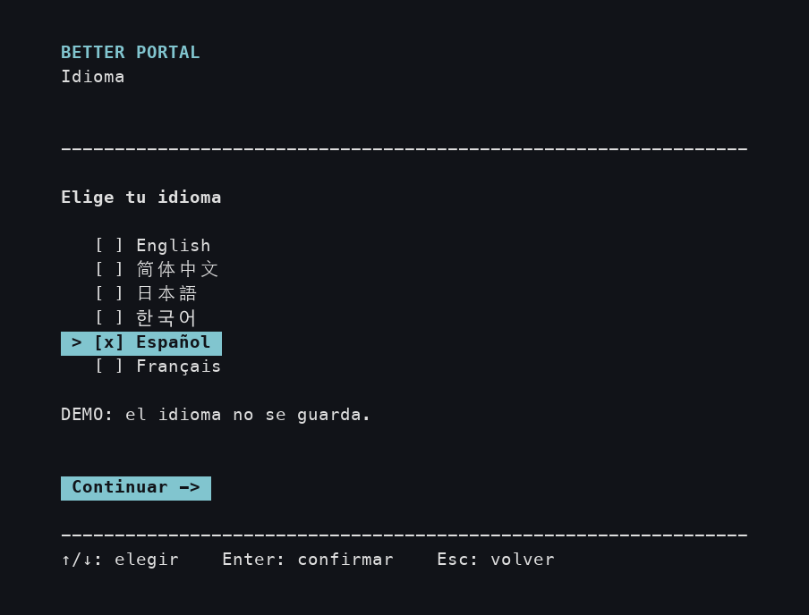

### 1. Prepara los dispositivos

En **Portal**, desliza hacia la izquierda desde la esquina superior derecha para abrir el menú rápido y elige **Desconectar**. Deja desactivada la opción de poner la PS5 conectada en modo de reposo para que siga encendida. La [guía de Sony sobre Uso a distancia (en inglés)](https://www.playstation.com/en-nz/support/hardware/playstation-remote-play-on-psportal/) te ayuda a encontrar el menú.

**Mantén Portal encendido y conectado al Wi-Fi.** Solo estás terminando la sesión de juego actual. Mantén también el Mac despierto y, si es un portátil, con la tapa abierta.

En el **Mac**, lee los avisos amarillos y pulsa **Return** para pasar a Equipos.

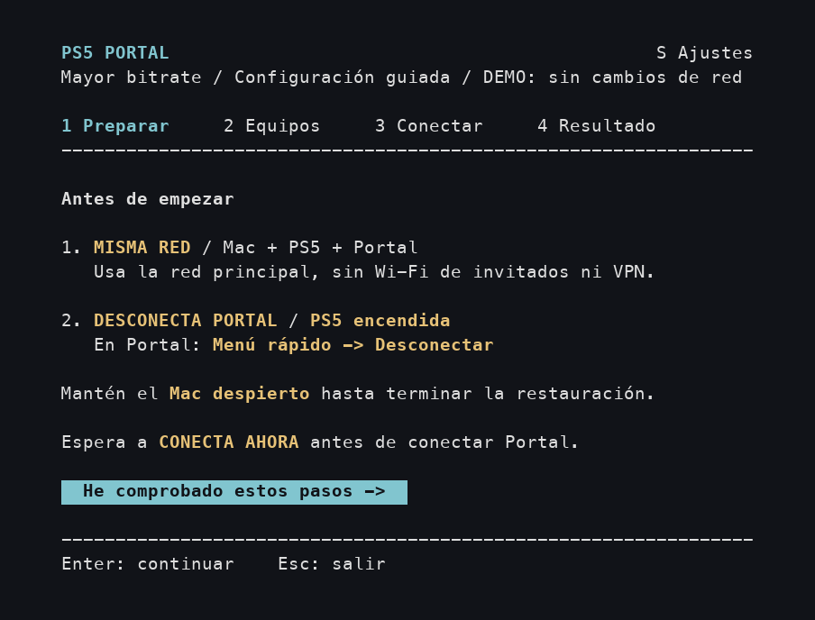

### 2. Introduce dos direcciones y mantén 65 Mbps

<a id="find-device-addresses"></a>

**Primero busca las direcciones de tu PS5 y de Portal.** Una dirección IPv4 identifica un dispositivo en la red de casa: son cuatro grupos de números separados por puntos. Los dos dispositivos tienen direcciones diferentes.

1. Abre la aplicación o página de administración que usas para el **router o Wi-Fi de casa**. El nombre depende del router o de tu proveedor de Internet.
2. Busca **Dispositivos**, **Dispositivos conectados** o **Clientes / Clients**. Abre la entrada de **PS5** y anota su **dirección IP / IPv4**. Haz lo mismo con **PlayStation Portal**.
3. Ten a mano esos dos números. Necesitas las direcciones de los dispositivos, no la del router, una dirección MAC ni el resultado de un test de velocidad. **No copies `192.168.1.20` ni `192.168.1.30` de esta guía.**

Como ejemplo con imágenes, [TP-Link Tether usa Local Device → Clients → el dispositivo (en inglés)](https://www.tp-link.com/us/support/faq/2611/). [ASUS también tiene una guía de su lista de dispositivos (en inglés)](https://www.asus.com/us/support/faq/1005513/). Si no sabes abrir la aplicación del router o identificar los dispositivos, pide esas dos direcciones locales a quien configuró tu Wi-Fi o a tu proveedor de Internet antes de continuar.

**Ahora rellena la pantalla del Mac de arriba abajo:**

| Fila | Qué hacer antes de pulsar Return |
| --- | --- |
| **IPv4 de PS5** | Escribe la dirección de la PS5 que has encontrado. |
| **IPv4 de Portal** | Escribe la dirección de Portal que has encontrado. |
| **Interfaz LAN del Mac** | Es el nombre del adaptador de red del Mac. Normalmente puedes dejar el valor propuesto, como `en0`. Si está vacío o usas otro adaptador, [compruébalo aquí](#mac-adapter). |
| **Bitrate (Mbps)** | Para la primera prueba, deja **65 recomendado** seleccionado. |
| **Guardar y preparar conexión** | Pulsa Return para empezar. Mantén Portal desconectado por ahora. |

Al entrar en un campo, empezar a escribir sustituye su contenido anterior. Usa **↑** para volver si te equivocas. Las direcciones y el bitrate se guardan para la próxima vez.

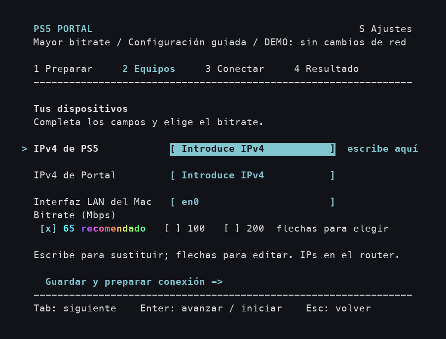

<details>
<summary>Ver las pulsaciones y el texto animado de la recomendación de 65 Mbps</summary>

Este ejemplo introduce direcciones de muestra, conserva el adaptador y 65 Mbps, y llega al botón de inicio. La animación se repite; lo que escribas en tu ventana se mantendrá.

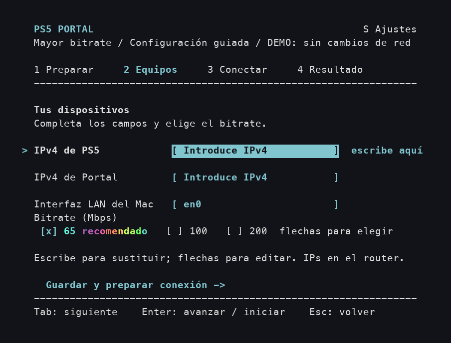

</details>

<details>
<summary>¿Cuándo probar 100 o 200 Mbps?</summary>

En la fila de bitrate, usa **← / →** o **Espacio** para elegir. Prueba **100 Mbps** después de una sesión estable a 65 Mbps. **200 Mbps** es experimental y puede aumentar los tirones. Compara la misma escena de juego; más no siempre es mejor.

</details>

### 3. Espera en el Mac y después conecta desde Portal

**Primero, ESPERA significa que debes esperar.** Deja Portal desconectado mientras el Mac comprueba los dispositivos y prepara la conexión.

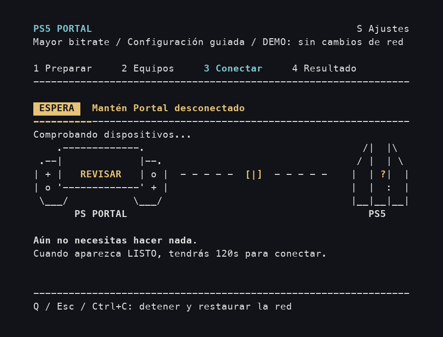

**Después, LISTO / CONECTA AHORA significa que debes coger Portal.** En su pantalla de inicio de Uso a distancia, selecciona tu PS5 y conéctate como de costumbre. Tienes **120 segundos** desde que el contador del Mac muestra **02:00**. La aplicación espera a que **tú inicies la conexión desde Portal**.

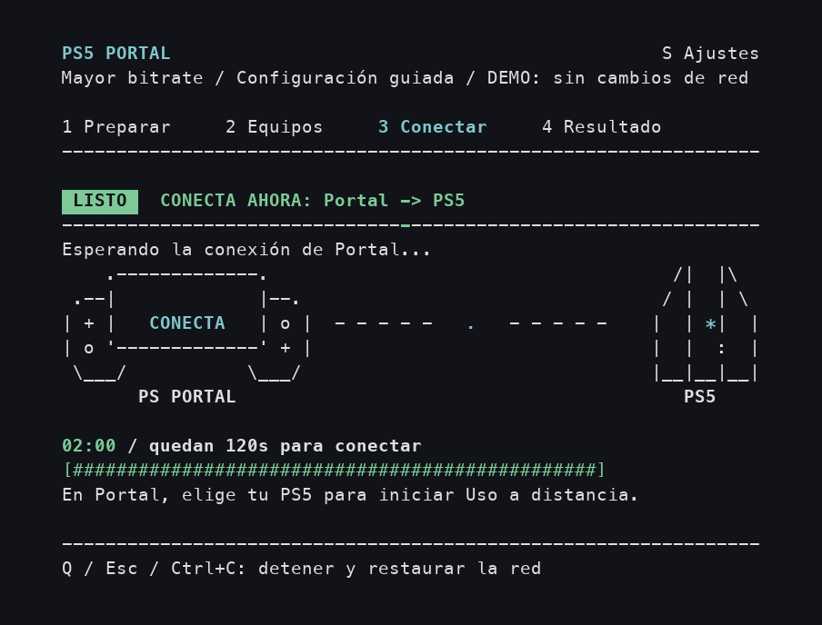

Cuando Portal se conecte, déjalo conectado. Espera a la pantalla **Resultado** del Mac antes de cerrar nada. Si se agota el tiempo, sigue las instrucciones del resultado para volver a intentarlo.

Para detener el intento antes, pulsa **Q** en el Mac y espera al resultado. Mantén el Mac despierto durante la restauración de la conexión.

<details>
<summary>Ver un ejemplo de conexión con la espera abreviada</summary>

Esta demo repetida pasa de ESPERA a CONECTA AHORA, las comprobaciones y el resultado correcto. Usa eventos simulados y acorta la espera. **El contador que debes seguir es el de tu aplicación.**


</details>

### 4. Confirma el objetivo y comprueba Portal

**Objetivo de bitrate confirmado** en verde y **`[OK]`** indican que PS5 informó del objetivo más alto. **Comprueba imagen, sonido y controles en Portal antes de jugar.** La herramienta no verifica la reproducción ni las tablas de direcciones de los dispositivos. Si la pantalla sigue negra, desconecta y vuelve a conectar normalmente sin Better Portal, y comunica el problema. Mantén el Mac despierto hasta que termine la restauración. Pulsa **Q** para salir y, cuando aparezca `Press Enter to close`, pulsa Return y cierra la ventana.

Las imágenes y animaciones muestran una versión anterior que llamaba a este resultado **Listo para jugar**. Ese mensaje también confirmaba únicamente el objetivo.

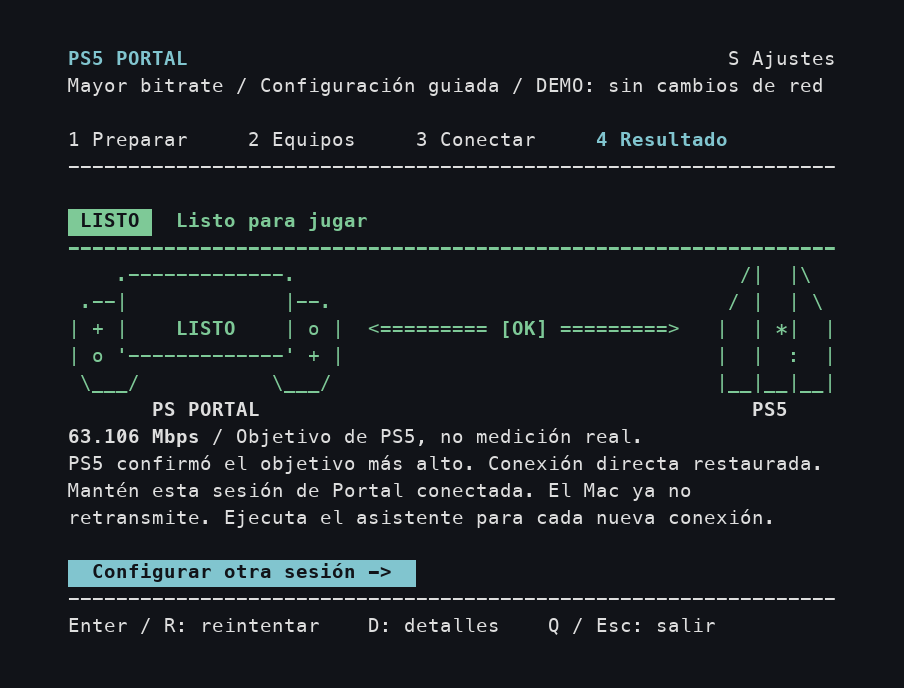

Un número como **63.106 Mbps** es el objetivo que ha comunicado la PS5, **no una medición del bitrate real del vídeo**. El Mac ya no necesita retransmitir los datos de esta sesión.

**La próxima vez que desconectes o apagues Portal:** vuelve a abrir **Start.command** y repite los cuatro pasos. Las direcciones guardadas aparecerán rellenas; revísalas si ha cambiado tu red.

## Si aparece otro resultado

Son **resultados alternativos**, no fases por las que debas pasar después de una sesión correcta.

| Mensaje del Mac | Qué hacer |
| --- | --- |
| **No se detectó una nueva conexión / Sin solicitud de inicio compatible** | Desconecta Portal de PS5 y pulsa **Return** para reintentar. Conecta desde Portal solo cuando vuelva a aparecer CONECTA AHORA. |
| **Objetivo más alto sin confirmar / Objetivo recibido; verificación incompleta** | Pulsa **D** para ver los detalles. Tras restaurar la red, conecta normalmente o reintenta con 65 Mbps. |
| **Intento detenido** | Lee el estado de restauración. Si ha terminado, reintenta con Return o sal con Q. |
| **Revisa la restauración de la red** | Mantén el Mac despierto y pulsa **D** para ver los detalles. Espera a que termine la recuperación antes de otro intento. |

<details>
<summary>Ver ejemplos separados de reintento y recuperación</summary>

**Sin nueva conexión:** inicia otro intento y conecta de nuevo desde Portal después de CONECTA AHORA.

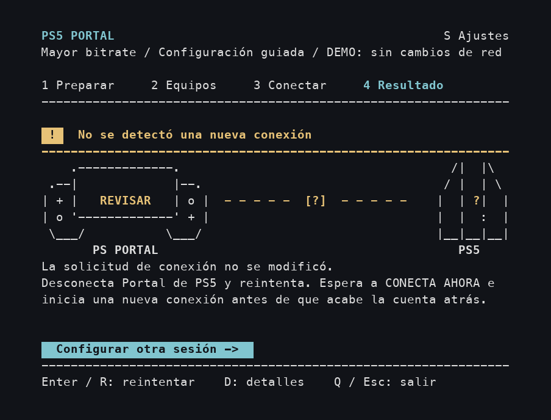

**Restauración pendiente:** mantén el Mac despierto y sigue las indicaciones de D: detalles.

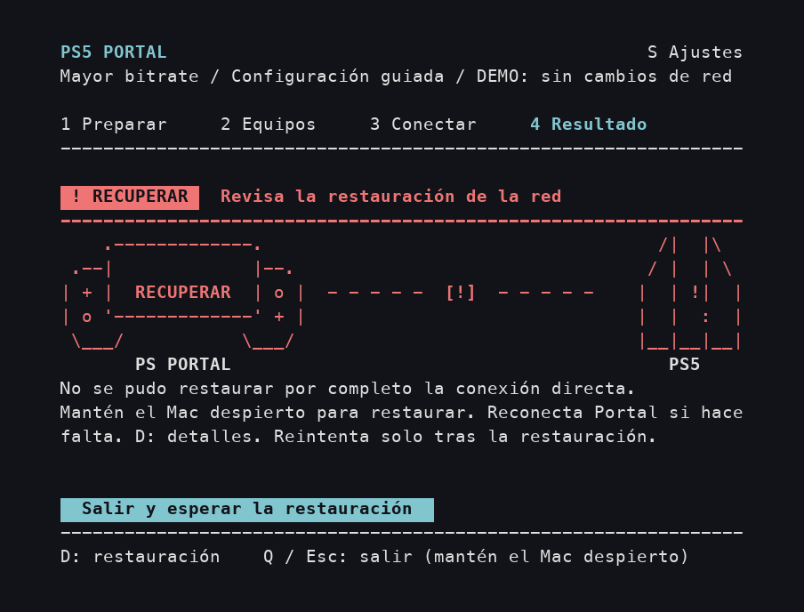

La [animación de resultados](docs/images/result-es.gif) muestra varios resultados simulados por separado para compararlos. Una sesión correcta no pasa por todos ellos.

</details>

## Cambiar el idioma durante el uso

Pulsa **S**, elige un idioma con las **flechas** y vuelve con **Enter, Esc o S**. El cambio se aplica al instante y se guarda. Esc cierra el panel sin deshacer el cambio. Los datos introducidos y el paso actual se mantienen.

Durante la conexión, el contador sigue avanzando aunque los ajustes estén abiertos. **Q** sigue deteniendo el intento. El panel se cierra cuando empieza la restauración de la red.

<details>
<summary>Ver el cambio inmediato de idioma y las distintas traducciones</summary>

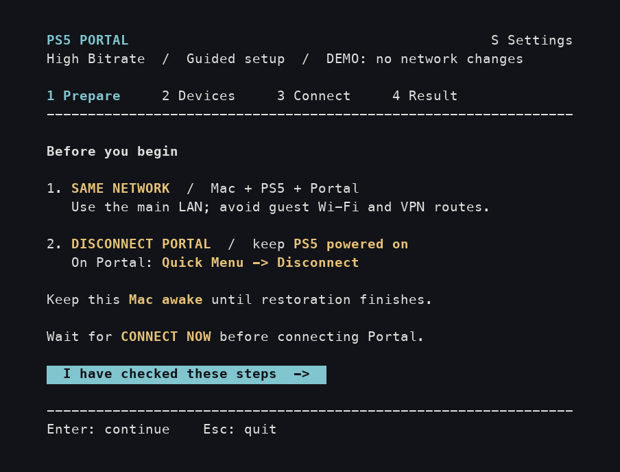

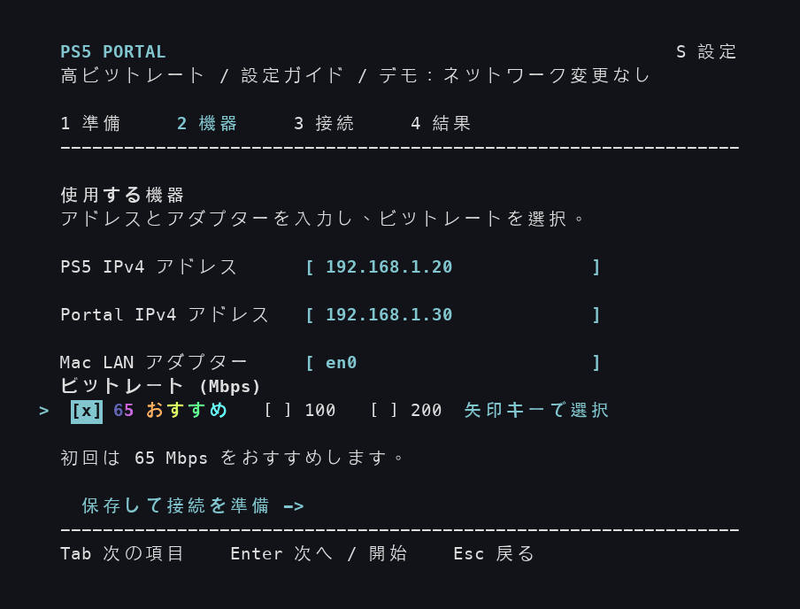

</details>

<a id="questions-and-fixes"></a>

## Preguntas y soluciones

<a id="macos-blocked"></a>

**macOS no abre el archivo: no puede verificar al desarrollador o Apple no puede comprobarlo.**

Después de intentar abrir el archivo descargado de este repositorio, ve a **menú Apple → Ajustes del Sistema → Privacidad y seguridad**. Busca el aviso del archivo bloqueado. Si confías en esta descarga, elige **Abrir igualmente** y confirma **Abrir**. Las [instrucciones con imágenes de Apple (en inglés)](https://support.apple.com/en-us/102445) explican estos avisos. Un aviso de que el archivo «dañará tu ordenador» es un caso diferente: detente y sigue la ayuda de Apple para ese aviso.

**Setup muestra un error de Python o de certificados en vez de «Setup complete».**

Completa el [apartado A](#install-python), incluido **Install Certificates.command**. Cierra la ventana del intento fallido y vuelve a abrir **Setup.command**. Si sigue fallando, copia el error cuando pidas ayuda.

**La contraseña no funciona o la cuenta no puede usar sudo.**

Usa la contraseña de inicio de sesión del Mac. Si tu cuenta no es administradora, pide a quien administra el Mac que te ayude a autorizar el inicio.

**El texto se corta o la aplicación pide una ventana más grande.**

Arrastra una esquina de Terminal para ampliarlo. La aplicación necesita al menos 72 columnas y 24 filas de texto. Vuelve a mostrarse cuando hay espacio suficiente.

**Un dispositivo no responde o la imagen da tirones.**

Mantén PS5 y Portal despiertos. Revisa las direcciones actuales y el Wi-Fi de casa. Si hay tirones, prueba 65 Mbps o desconecta Portal y vuelve a conectarlo normalmente sin ejecutar Better Portal.

**¿Se guarda mi contraseña del Mac?**

No. macOS gestiona la autorización. Reintentar dentro del mismo asistente abierto no vuelve a pedirla.

**¿Cómo pido ayuda?**

[Abre una incidencia](https://github.com/wchwawa/better-portal/issues) e indica el paso y el mensaje que aparecen, las versiones de macOS y Portal, y el bitrate elegido. Oculta las direcciones de los dispositivos en las capturas antes de compartirlas. Los informes y las capturas de paquetes pueden contener información privada de la red; consérvalos en tu equipo.

<a id="terminal-help"></a>

<details>
<summary>Ayuda con Terminal: abrir la carpeta, probar la demo y resolver un archivo Python que falta</summary>

Para abrir Terminal manualmente, pulsa **Comando (⌘) + Espacio**, escribe **Terminal** y pulsa Return.

1. Escribe `cd` seguido de **un espacio**.
2. Arrastra la **carpeta better-portal-main** desde Finder hasta Terminal y pulsa Return. Así le indicas qué carpeta debe usar.
3. Copia **un comando cada vez** de los siguientes, pégalo en Terminal y pulsa Return. Copia solo el texto del comando.

Si Start no encuentra `.venv/bin/python`, ejecuta primero la instalación desde esa carpeta:

```sh
./Setup.command
```

Después, para preparar una sesión real:

```sh
./Start.command
```

Para **ver solo la demo**, después de instalar:

```sh
.venv/bin/python portal_tui.py --demo
```

Para **ver la demo sin animaciones**:

```sh
.venv/bin/python portal_tui.py --demo --no-animations
```

Los dos comandos de demo simulan una conexión sin usar tus dispositivos. No necesitan contraseña de administrador, no cambian la red ni guardan ajustes. Cierra la demo antes de abrir Start.command para una sesión real.

</details>

<a id="mac-adapter"></a>

<details>
<summary>La interfaz LAN del Mac está vacía o uso un adaptador USB / Ethernet</summary>

La interfaz es un nombre como `en0`, no el nombre del Wi-Fi ni una dirección IP. Abre Terminal como se explica arriba y ejecuta:

```sh
networksetup -listallhardwareports
```

Para Wi-Fi, busca la sección **Hardware Port: Wi-Fi** y usa el nombre que aparece junto a **Device:**. Para una conexión por cable, busca la sección del adaptador Ethernet conectado. Introduce ese nombre en Better Portal. Si no sabes qué adaptador estás usando, indícalo al pedir ayuda.

</details>

<details>
<summary>¿Ya usas Git y Terminal?</summary>

```sh
git clone https://github.com/wchwawa/better-portal.git
cd better-portal
./Setup.command
./Start.command
```

</details>

**¿Usas Linux?** Consulta la [guía de Linux / configuración automática original](https://github.com/atameric/ps5-portal-high-bitrate/blob/main/AUTOMATION.md).
