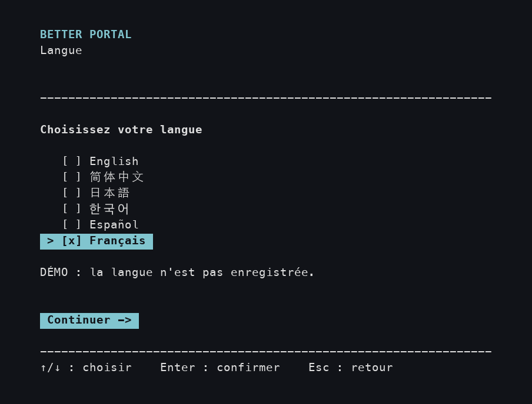
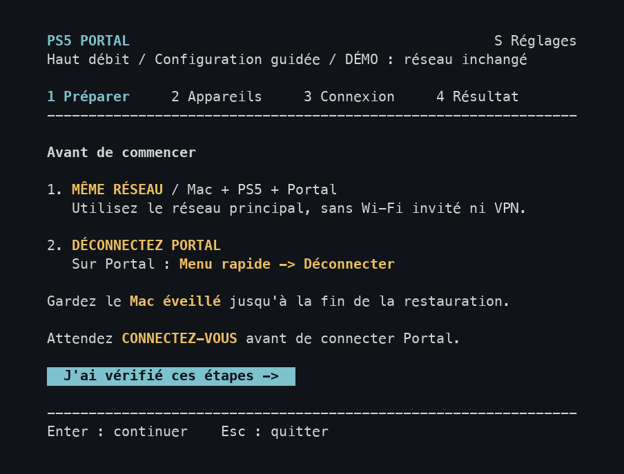
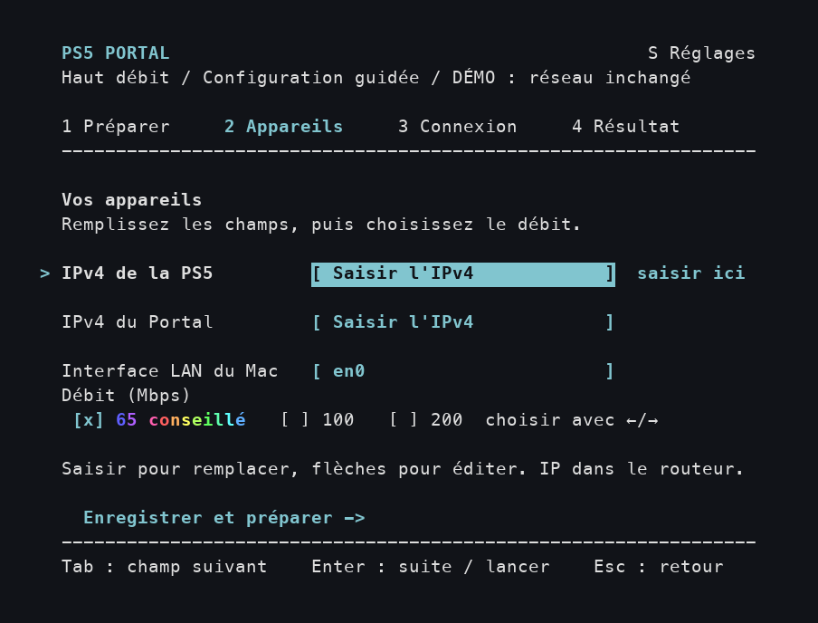
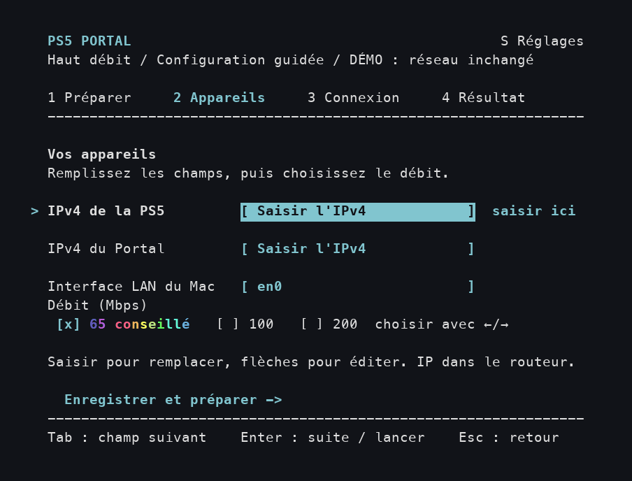
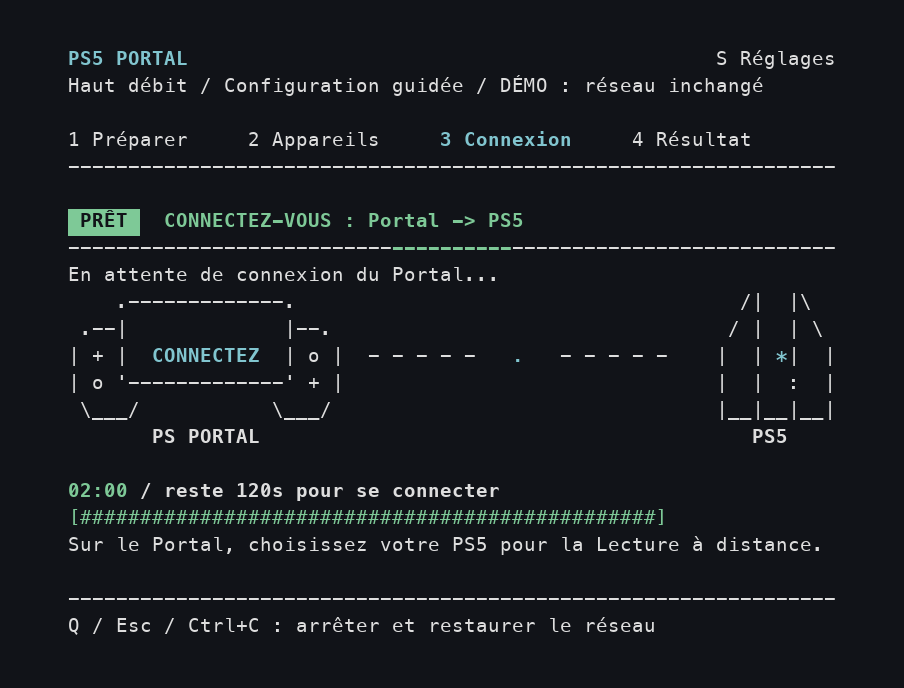
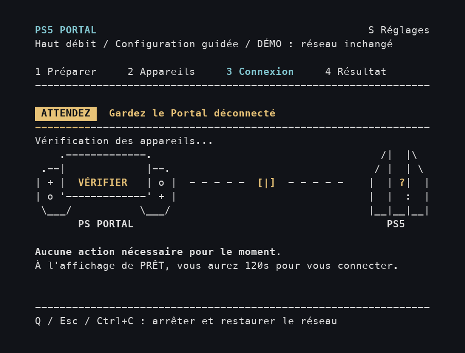
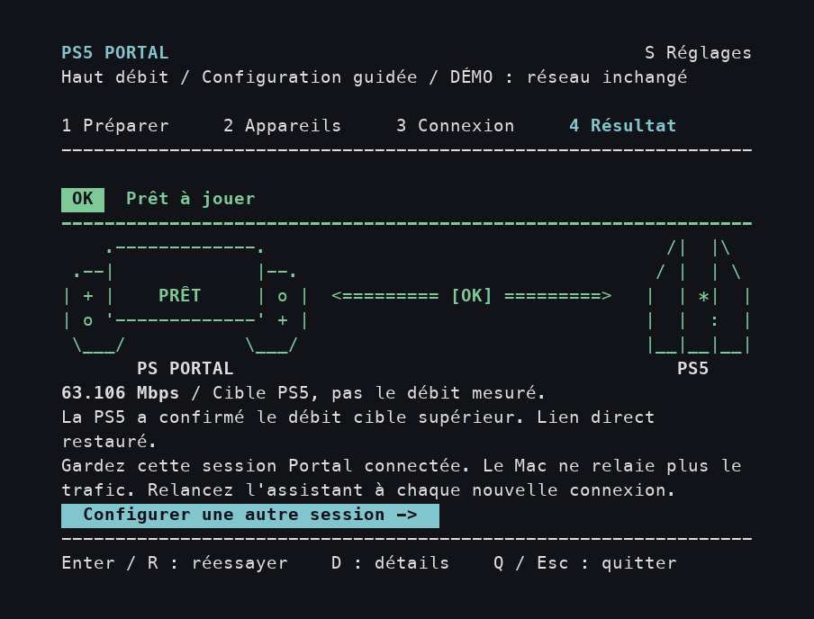
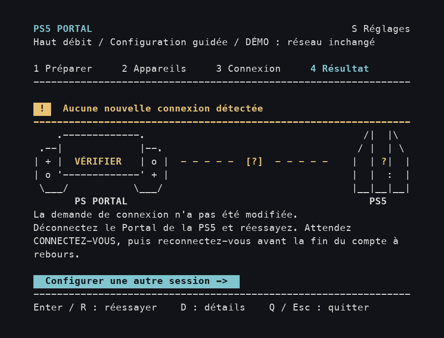
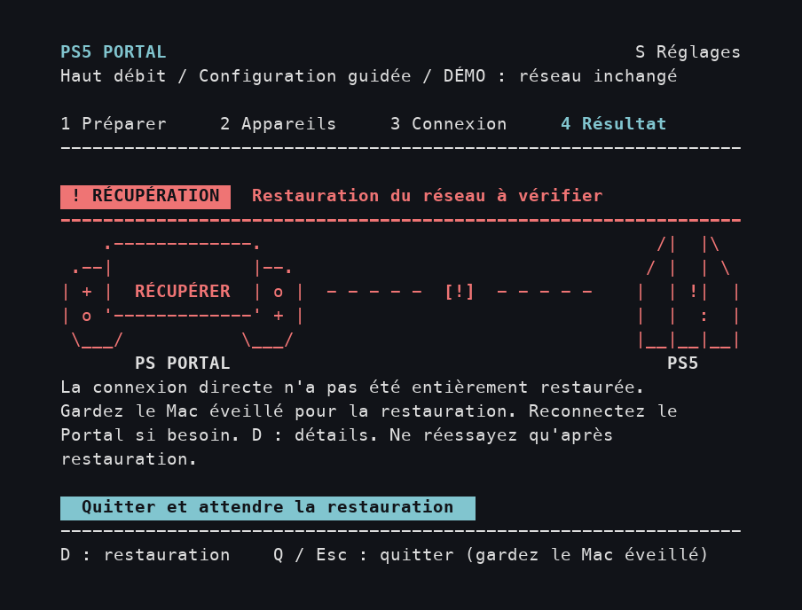

## Remerciements

La méthode d’origine pour modifier le débit vient de **[@atameric](https://github.com/atameric)** et de [ps5-portal-high-bitrate](https://github.com/atameric/ps5-portal-high-bitrate). Vous pouvez [soutenir le créateur d’origine](https://buymeacoffee.com/atameric).

Sous licence [MIT](LICENSE). Logiciel communautaire indépendant ; sans affiliation avec Sony ou PlayStation.

# Better Portal

[English](README.md) · [简体中文](README.zh-CN.md) · [日本語](README.ja.md) · [한국어](README.ko.md) · [Español](README.es.md) · **Français** · [Türkçe](README.tr.md)

[Rejoignez la communauté Discord](https://discord.gg/C957je4ehv)

Choisissez un débit cible pour améliorer l’image lorsque vous jouez à votre PS5 depuis PlayStation Portal. Better Portal vous guide dans la configuration sur **macOS ou Windows**, un écran à la fois.

[Démarrage rapide sur macOS](#macos-quick-start) · [Démarrage rapide sur Windows](#windows-quick-start) · [Première session](#first-session) · [Trouver les adresses](#find-device-addresses) · [Résoudre un problème](#questions-and-fixes)

## Avant de commencer

Préparez les éléments suivants :

- Un **Mac ou PC sous Windows 10/11**, une **PS5** et une **PlayStation Portal**. Vous devez déjà pouvoir jouer à votre PS5 depuis Portal avec la Lecture à distance.
- Les trois appareils connectés au **même routeur de votre domicile**. L’ordinateur et Portal peuvent utiliser le Wi-Fi ; la PS5 peut utiliser ce Wi-Fi ou un câble réseau relié au routeur. Évitez le réseau invité et déconnectez le VPN de l’ordinateur si vous en utilisez un.
- Une connexion Internet pour l’installation et la possibilité d’autoriser Better Portal sur l’ordinateur.

Il s’agit d’un outil communautaire expérimental. Commencez par **65 Mbps**. Le débit indique la quantité de données d’image envoyée chaque seconde. L’augmenter peut améliorer les détails, mais aussi provoquer des saccades si la connexion est instable.

<a id="get-started"></a>

## Démarrage rapide

L’installation ne se fait qu’une fois. Pour les installations ZIP, conservez tout le dossier téléchargé : il contient le fichier à ouvrir chaque fois que vous souhaitez jouer.

Choisissez les instructions pour **votre ordinateur**.

| Votre ordinateur | Première installation | Démarrer une session |
| --- | --- | --- |
| **macOS — Homebrew** | Exécutez les deux commandes ci-dessous | Lancez **`better-portal`** |
| **macOS — ZIP** | Double-cliquez sur **Setup.command** | Double-cliquez sur **Start.command** |
| **Windows 10 / 11** | Double-cliquez sur **Start-Windows.cmd** | Double-cliquez sur **Start-Windows.cmd** |

<a id="macos-quick-start"></a>

### Démarrage rapide sur macOS

#### Installer et mettre à jour avec Homebrew (Mac)

Si vous utilisez [Homebrew](https://brew.sh), exécutez ces deux lignes dans Terminal. Homebrew installe aussi Python et les paquets nécessaires :

```sh
brew tap wchwawa/better-portal https://github.com/wchwawa/better-portal
brew install --HEAD wchwawa/better-portal/better-portal
```

Lancez l’assistant avec **`better-portal`**. Fermez-le avant une mise à jour, puis lancez **`better-portal update`**. Les adresses, la langue, le débit et les rapports restent dans votre dossier utilisateur. Cette option suit la dernière version de la branche `main` ; les connexions réelles demandent toujours le mot de passe du Mac si nécessaire. [Guide complet et importation des anciens réglages](docs/homebrew.md). L’installation ZIP ci-dessous reste disponible.

Après chaque mise à jour, le Terminal affiche la version installée et ses changements. Lancez **`better-portal changes`** pour les relire, même hors ligne. Les titres suivent la langue enregistrée ; les descriptions conservent le texte anglais des commits d’origine.

Ces étapes concernent l’installation ZIP. Si vous avez installé avec Homebrew, lancez **`better-portal`** et passez à **Votre première session**. Utilisez cette commande partout où le guide indique d’ouvrir Start.command.

#### Installer depuis le ZIP

<a id="install-python"></a>

1. **Installez Python :** ouvrez la [page officielle de Python pour Mac](https://www.python.org/downloads/macos/), choisissez un **Python 3.14 macOS installer**, puis ouvrez le `.pkg` téléchargé. Suivez **Continuer → Installer**. Si Python 3.10 ou une version ultérieure est déjà installé, vous pouvez le conserver.
2. **Terminez l’installation de Python :** dans Finder, ouvrez **Applications → Python 3.14** et double-cliquez sur **Install Certificates.command**. Attendez `update complete`, puis fermez la fenêtre. Pour une autre version, utilisez le dossier Python correspondant. Consultez les [instructions officielles](https://docs.python.org/3.14/using/mac.html).
3. **Téléchargez Better Portal :** [téléchargez le ZIP](https://github.com/wchwawa/better-portal/archive/refs/heads/main.zip), ouvrez **Finder → Téléchargements** et double-cliquez sur le ZIP pour le décompresser. Ouvrez le dossier **better-portal-main**.
4. **Configurez une fois :** double-cliquez sur **Setup.command**. Terminal s’ouvre. Attendez **`Setup complete.`**, appuyez sur **Return**, puis fermez la fenêtre.
5. **Démarrez une session :** double-cliquez sur **Start.command** dans le même dossier. Si **`Password:`** apparaît, saisissez le **mot de passe de votre session Mac**, puis appuyez sur **Return**. **Aucune lettre ni aucun point ne s’affiche pendant la saisie : c’est normal.** Continuez avec [Votre première session](#first-session).

Si macOS bloque un fichier, consultez [« macOS refuse d’ouvrir le fichier »](#macos-blocked). Si l’installation échoue, consultez [Questions et solutions](#questions-and-fixes) avant de démarrer une session.

<a id="windows-quick-start"></a>

### Démarrage rapide sur Windows

Le même assistant est disponible sous **Windows 11 et Windows 10**. Les essais sur appareils réels sous Windows sont encore en cours ; consultez le [guide Windows (en anglais)](WINDOWS.md).

1. Téléchargez le [ZIP Better Portal](https://github.com/wchwawa/better-portal/archive/refs/heads/main.zip). Faites un clic droit → **Extraire tout**, puis ouvrez le dossier extrait.
2. Double-cliquez sur **Start-Windows.cmd**. Le lanceur vérifie Python et installe les dépendances manquantes. Si Python manque, il utilise le Gestionnaire de package Windows ; si celui-ci est indisponible, il ouvre la page officielle d'installation de Python.
3. Si l'installation de **Npcap** est demandée, suivez la page officielle qui s'ouvre. Laissez **le mode de compatibilité WinPcap décoché**. Terminez l'installation, puis appuyez sur **Entrée** dans la fenêtre de démarrage. Cette étape est ignorée si Npcap est déjà installé.
4. Acceptez l'autorisation Windows. Choisissez la langue, saisissez les deux adresses IPv4, puis utilisez **← / →** pour choisir l'adaptateur Wi-Fi ou Ethernet du PC et le débit. Gardez Portal déconnecté jusqu'à **CONNECT NOW**, puis connectez-le à la PS5 dans les **120 secondes**.

**La prochaine fois, double-cliquez simplement sur Start-Windows.cmd.** Aucune étape Setup séparée ni commande à saisir n'est nécessaire. Ce démarrage rapide prend en charge les PC Windows x64.

Les langues, les réglages avec **S**, les animations, les étapes et les résultats sont communs à la version Mac illustrée ci-dessous. Sous Windows, choisissez **Adaptateur LAN du PC**. La langue, les adresses et le débit sont enregistrés. Même si le débit cible est confirmé, vérifiez l’image, le son et les commandes sur Portal.

**Pour les installations ZIP sur les deux plateformes :** conservez tout le dossier extrait et ouvrez son fichier Start pour chaque nouvelle session. Les adresses, la langue et le débit sont enregistrés. L’installation et le lancement se font en double-cliquant sur ces fichiers ; vous n’avez pas besoin de modifier le code.

<a id="first-session"></a>

## Votre première session

**Utilisez le clavier de votre ordinateur dans l’assistant.** Cliquez une fois dans la fenêtre Terminal pour qu’elle reçoive les frappes. Les boutons colorés se sélectionnent avec les touches. La touche **Return** ou **Entrée** du Mac correspond à **Enter** à l’écran.

| Touche | Action |
| --- | --- |
| **Return / Enter** | Confirmer un choix, passer au champ suivant ou activer le bouton sélectionné. |
| **Tab** ou **↑ / ↓** | Passer d’un champ d’appareil à l’autre. `>` indique la ligne actuelle. |
| **← / →** | Changer le débit lorsque sa ligne est sélectionnée. `[x]` indique l’option choisie. |
| **S** | Ouvrir les réglages pour changer de langue. Appuyez une fois sur la lettre ; Return n’est pas nécessaire. |

Les images montrent **l’application réelle en mode démo sur Mac**. Windows suit les mêmes étapes et utilise un sélecteur d’adaptateur PC à la place du champ d’interface du Mac. La mention « DÉMO » et les adresses servent d’exemples. **Saisissez les adresses de vos appareils et suivez le compte à rebours de votre application.** Cliquez sur une image pour l’agrandir.

### Choisir la langue

Utilisez **↑ / ↓** pour choisir **Français, English, 简体中文, 日本語, 한국어 ou Español**, puis appuyez sur **Return**. Votre choix est mémorisé. Si vous arrivez directement à Préparer, une langue a déjà été enregistrée ; **S** permet de la changer.



### 1. Préparer les appareils

Sur **Portal**, balayez vers la gauche depuis le coin supérieur droit pour ouvrir le menu rapide, puis choisissez **Déconnecter**. Le [guide de Lecture à distance de Sony (en anglais)](https://www.playstation.com/en-nz/support/hardware/playstation-remote-play-on-psportal/) peut vous aider à trouver le menu.

**Gardez Portal allumé et connecté au Wi-Fi.** Vous terminez uniquement la session de jeu en cours. Gardez aussi l’ordinateur éveillé et, s’il s’agit d’un portable, laissez son écran ouvert.

Sur **l’ordinateur**, lisez les rappels en jaune, puis appuyez sur **Return** pour passer à Appareils.



### 2. Saisir deux adresses et conserver 65 Mbps

<a id="find-device-addresses"></a>

**Trouvez d’abord les adresses de votre PS5 et de Portal.** Une adresse IPv4 identifie un appareil sur le réseau de la maison : elle contient quatre groupes de chiffres séparés par des points. Les deux appareils ont des adresses différentes.

1. Ouvrez l’application ou la page d’administration que vous utilisez pour le **routeur, la box ou le Wi-Fi de la maison**. Son nom dépend du fabricant ou du fournisseur d’accès Internet.
2. Cherchez **Appareils**, **Appareils connectés** ou **Clients**. Ouvrez l’entrée de la **PS5** et notez son **adresse IP / IPv4**. Faites de même pour **PlayStation Portal**.
3. Gardez ces deux adresses à portée de main. Il faut celles des appareils, et non celle du routeur, une adresse MAC ou le résultat d’un test de vitesse. **Ne recopiez pas `192.168.1.20` et `192.168.1.30` depuis ce guide.**

Pour un exemple illustré, [TP-Link Tether utilise Local Device → Clients → l’appareil (en anglais)](https://www.tp-link.com/us/support/faq/2611/). [ASUS propose aussi un guide de sa liste d’appareils (en anglais)](https://www.asus.com/us/support/faq/1005513/). Si vous ne savez pas ouvrir l’application du routeur ou reconnaître les appareils, demandez ces deux adresses locales à la personne qui a configuré votre Wi-Fi ou à votre fournisseur d’accès avant de continuer.

**Remplissez ensuite l’écran de l’ordinateur de haut en bas :**

| Ligne | Action à effectuer avant d’appuyer sur Return |
| --- | --- |
| **IPv4 de la PS5** | Saisissez l’adresse de la PS5 que vous avez trouvée. |
| **IPv4 du Portal** | Saisissez l’adresse de Portal que vous avez trouvée. |
| **Interface LAN du Mac** — macOS uniquement | Gardez généralement la valeur proposée, comme `en0`. Si le champ est vide ou si vous utilisez un autre adaptateur, [vérifiez ici](#mac-adapter). |
| **Adaptateur LAN du PC** — Windows uniquement | Utilisez **← / →** pour choisir l’adaptateur Wi-Fi ou Ethernet connecté au routeur de votre domicile. |
| **Débit (Mbps)** | Pour le premier essai, laissez **65 conseillé** sélectionné. |
| **Enregistrer et préparer** | Appuyez sur Return pour commencer. Gardez Portal déconnecté pour le moment. |

Quand vous arrivez dans un champ, commencer à écrire remplace son ancienne valeur. Utilisez **↑** pour revenir corriger une erreur. Les adresses et le débit sont enregistrés pour la prochaine fois.



<details>
<summary>Voir les touches utilisées et la recommandation de 65 Mbps aux couleurs animées</summary>

Cet exemple saisit des adresses fictives, conserve l’adaptateur et 65 Mbps, puis arrive au bouton de démarrage. L’animation tourne en boucle ; vos saisies resteront en place dans votre fenêtre.



</details>

<details>
<summary>Quand essayer 100 ou 200 Mbps ?</summary>

Sur la ligne du débit, utilisez **← / →** ou **Espace** pour choisir. Essayez **100 Mbps** après une session stable à 65 Mbps. **200 Mbps** est expérimental et peut accentuer les saccades. Comparez la même scène de jeu : une valeur plus élevée n’est pas toujours meilleure.

</details>

### 3. Attendre sur l’ordinateur, puis se connecter depuis Portal

**D’abord, ATTENDEZ signifie qu’il faut patienter.** Gardez Portal déconnecté pendant que l’ordinateur vérifie les appareils et prépare la connexion.


**Ensuite, PRÊT / CONNECTEZ-VOUS signifie qu’il faut prendre Portal.** Sur son écran d’accueil de Lecture à distance, choisissez votre PS5 et connectez-vous comme d’habitude. Vous avez **120 secondes**, à partir de **02:00** sur l’ordinateur. L’application attend que **vous lanciez vous-même la connexion sur Portal**.



Une fois Portal connecté, laissez-le connecté. Attendez l’écran **Résultat** sur l’ordinateur avant de fermer quoi que ce soit. Si le temps s’écoule, suivez les instructions de ce résultat pour réessayer.

Pour arrêter plus tôt, appuyez sur **Q** sur l’ordinateur et attendez le résultat. Gardez l’ordinateur éveillé pendant la restauration de la connexion.

<details>
<summary>Voir un exemple de connexion avec une attente raccourcie</summary>

Cette démo passe d’ATTENDEZ à CONNECTEZ-VOUS, puis aux vérifications et au résultat réussi, avant de recommencer. Elle utilise des événements simulés et une attente raccourcie. **Suivez le compte à rebours de votre propre application.**



</details>

### 4. Confirmer le débit cible, puis vérifier Portal

**Débit cible confirmé** en vert avec **`[OK]`** signifie que la PS5 a signalé le débit cible supérieur. **Vérifiez l’image, le son et les commandes sur Portal avant de jouer.** L’outil ne vérifie ni la lecture ni les tables d’adresses des appareils. Si l’écran reste noir, déconnectez-vous puis reconnectez-vous normalement sans Better Portal, et signalez le problème. Gardez l’ordinateur éveillé jusqu’à la fin de la restauration. Appuyez sur **Q** pour quitter, puis sur Return quand `Press Enter to close` apparaît, et fermez la fenêtre.

Les images et animations montrent une ancienne version qui appelait ce résultat **Prêt à jouer**. Ce message confirmait lui aussi uniquement le débit cible.



Un nombre comme **63.106 Mbps** est la cible annoncée par la PS5, **pas une mesure du débit vidéo réel**. L’ordinateur n’a plus besoin de relayer les données de cette session.

**La prochaine fois que vous déconnectez ou éteignez Portal :** ouvrez **Start.command** sur Mac ou **Start-Windows.cmd** sur Windows et répétez les quatre étapes. Les adresses enregistrées seront préremplies ; vérifiez-les si votre réseau a changé.

## Si le résultat est différent

Il s’agit de **résultats possibles distincts**, pas d’étapes à attendre après une réussite.

| Message dans l’assistant | Action suivante |
| --- | --- |
| **Aucune nouvelle connexion détectée / Aucune demande de démarrage compatible** | Déconnectez Portal de la PS5 et appuyez sur **Return** pour réessayer. Lancez la connexion sur Portal seulement après le prochain CONNECTEZ-VOUS. |
| **Débit cible supérieur non confirmé / Cible reçue ; vérification incomplète** | Appuyez sur **D** pour les détails. Après restauration du réseau, reconnectez-vous normalement ou réessayez à 65 Mbps. |
| **Essai arrêté** | Lisez l’état de la restauration. Si elle est terminée, réessayez avec Return ou quittez avec Q. |
| **Restauration du réseau à vérifier** | Gardez l’ordinateur éveillé. Appuyez sur **D** pour les détails et attendez la fin de la récupération avant un nouvel essai. |

<details>
<summary>Voir séparément les exemples de nouvel essai et de récupération</summary>

**Aucune nouvelle connexion :** relancez un essai et établissez une nouvelle connexion sur Portal après CONNECTEZ-VOUS.



**Restauration à vérifier :** gardez l’ordinateur éveillé et suivez les indications de D : détails.



L’[animation des résultats](docs/images/result-fr.gif) montre différents résultats simulés pour les comparer. Une session réussie ne passe pas par tous ces écrans.

</details>

## Changer de langue pendant l’utilisation

Appuyez sur **S**, choisissez la langue avec les **flèches**, puis revenez avec **Enter, Esc ou S**. Le changement est immédiat et enregistré. Esc ferme le panneau sans annuler la modification. Vos saisies et l’étape actuelle restent en place.

Pendant la connexion, le compte à rebours continue même si les réglages sont ouverts. **Q** permet toujours d’arrêter l’essai. Le panneau se ferme au début de la restauration du réseau.

<details>
<summary>Voir le changement immédiat de langue et les différentes traductions</summary>


</details>


<a id="troubleshooting-and-recovery"></a>

<a id="questions-and-fixes"></a>

## Questions et solutions

**Un problème avec l’installation, les autorisations, Npcap ou l’adaptateur sous Windows ?**

Consultez le [guide de dépannage Windows (en anglais)](WINDOWS.md#questions-and-fixes). Les fichiers `.command` et les instructions d’adaptateur Mac ci-dessous concernent macOS.

<a id="macos-blocked"></a>

**macOS refuse d’ouvrir le fichier : le développeur ne peut pas être vérifié ou Apple ne peut pas le vérifier.**

Après avoir essayé d’ouvrir le fichier téléchargé depuis ce dépôt, allez dans **menu Apple → Réglages Système → Confidentialité et sécurité**. Trouvez l’avis du fichier bloqué. Si vous faites confiance à ce téléchargement, choisissez **Ouvrir quand même**, puis confirmez **Ouvrir**. Les [instructions illustrées d’Apple (en anglais)](https://support.apple.com/en-us/102445) expliquent ces messages. Une alerte indiquant que le fichier « endommagera votre ordinateur » est un autre cas : arrêtez-vous et suivez les instructions d’Apple pour cette alerte.

**Setup affiche une erreur Python ou de certificat au lieu de « Setup complete ».**

Suivez les [étapes Python sur macOS](#macos-quick-start), y compris **Install Certificates.command**. Fermez la fenêtre de l’installation échouée, puis ouvrez de nouveau **Setup.command**. Si l’erreur persiste, copiez son texte lorsque vous demandez de l’aide.

**Le mot de passe ne fonctionne pas ou le compte ne peut pas utiliser sudo.**

Utilisez le mot de passe de votre session Mac. Si votre compte n’est pas administrateur, demandez à la personne qui gère le Mac de vous aider à autoriser le lancement.

**Le texte est coupé ou l’application demande une fenêtre plus grande.**

Agrandissez Terminal en faisant glisser un coin de la fenêtre. L’application a besoin d’au moins 72 colonnes et 24 lignes de texte. Elle reprend l’affichage dès que l’espace est suffisant.

**Un appareil ne répond pas ou l’image est saccadée.**

Gardez Portal éveillé. Vérifiez les adresses actuelles des deux appareils et le Wi-Fi de la maison. En cas de saccades, essayez 65 Mbps ou déconnectez Portal, puis reconnectez-le normalement sans lancer Better Portal.

**Mon mot de passe administrateur sera-t-il enregistré ?**

Non. macOS ou Windows gère l’autorisation. Réessayer dans le même assistant resté ouvert ne demande pas à nouveau le mot de passe.

**Comment demander de l’aide ?**

[Ouvrez une issue](https://github.com/wchwawa/better-portal/issues) en indiquant l’étape et le message affichés, les versions du système d’exploitation de votre ordinateur et de Portal, ainsi que le débit choisi. Masquez les adresses des appareils dans les captures d’écran avant de les partager. Les rapports bruts et captures de paquets peuvent contenir des informations privées sur votre réseau ; gardez-les sur votre ordinateur.

<a id="terminal-help"></a>

<details>
<summary>Aide Terminal sur macOS : ouvrir le dossier, essayer la démo et retrouver le fichier Python manquant</summary>

Pour ouvrir Terminal manuellement, appuyez sur **Commande (⌘) + Espace**, tapez **Terminal**, puis appuyez sur Return.

1. Tapez `cd` suivi d’**un espace**.
2. Faites glisser le **dossier better-portal-main** du Finder dans Terminal, puis appuyez sur Return. Vous indiquez ainsi le dossier à utiliser.
3. Copiez **une commande à la fois** ci-dessous, collez-la dans Terminal, puis appuyez sur Return. Copiez uniquement le texte de la commande.

Si Start ne trouve pas `.venv/bin/python`, lancez d’abord l’installation depuis ce dossier :

```sh
./Setup.command
```

Ensuite, pour préparer une vraie session :

```sh
./Start.command
```

Pour **voir uniquement la démo**, après l’installation :

```sh
.venv/bin/python portal_tui.py --demo
```

Pour **voir la démo sans animation** :

```sh
.venv/bin/python portal_tui.py --demo --no-animations
```

Ces deux commandes simulent une connexion sans utiliser vos appareils. Elles ne demandent pas de mot de passe administrateur, ne modifient pas le réseau et n’enregistrent aucun réglage. Quittez la démo avant d’ouvrir Start.command pour une vraie session.

</details>

<a id="mac-adapter"></a>

<details>
<summary>L’interface LAN du Mac est vide, ou j’utilise un adaptateur USB / Ethernet</summary>

L’interface est un nom comme `en0`, pas le nom du Wi-Fi ni une adresse IP. Ouvrez Terminal comme indiqué plus haut, puis exécutez :

```sh
networksetup -listallhardwareports
```

Pour le Wi-Fi, cherchez la section **Hardware Port: Wi-Fi** et utilisez le nom après **Device:**. Pour une connexion par câble, trouvez la section de l’adaptateur Ethernet connecté. Saisissez ce nom dans Better Portal. Si vous ne savez pas quel adaptateur est utilisé, précisez-le dans votre demande d’aide.

</details>

<details>
<summary>Vous utilisez déjà Git et Terminal sur Mac ?</summary>

```sh
git clone https://github.com/wchwawa/better-portal.git
cd better-portal
./Setup.command
./Start.command
```

</details>

**Sur Linux ?** Consultez le [guide Linux / configuration automatique du projet d’origine](https://github.com/atameric/ps5-portal-high-bitrate/blob/main/AUTOMATION.md).
