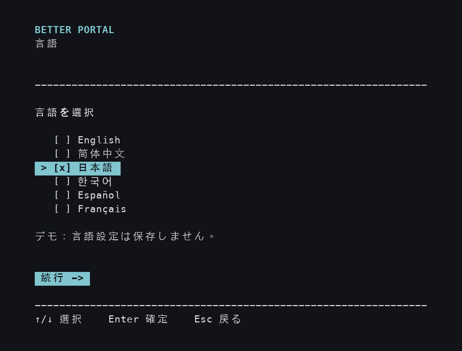
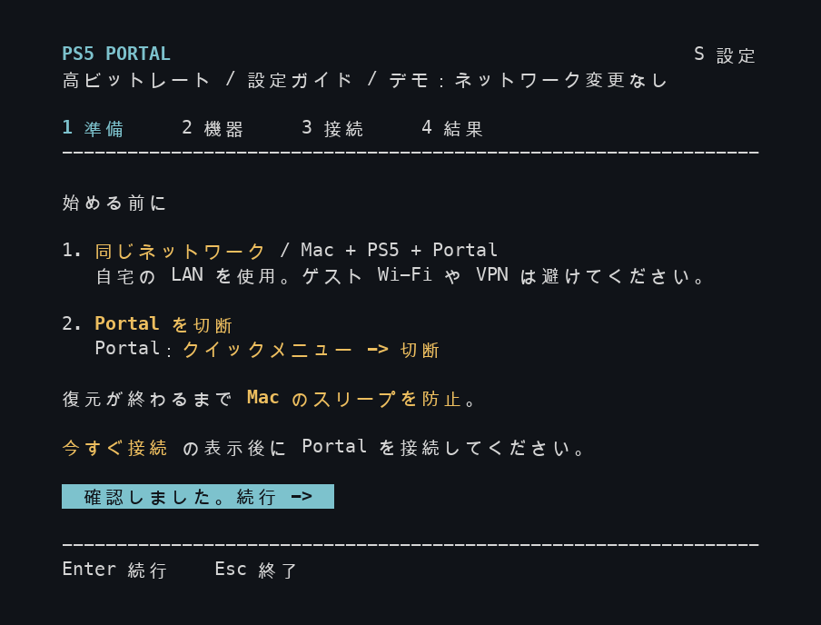
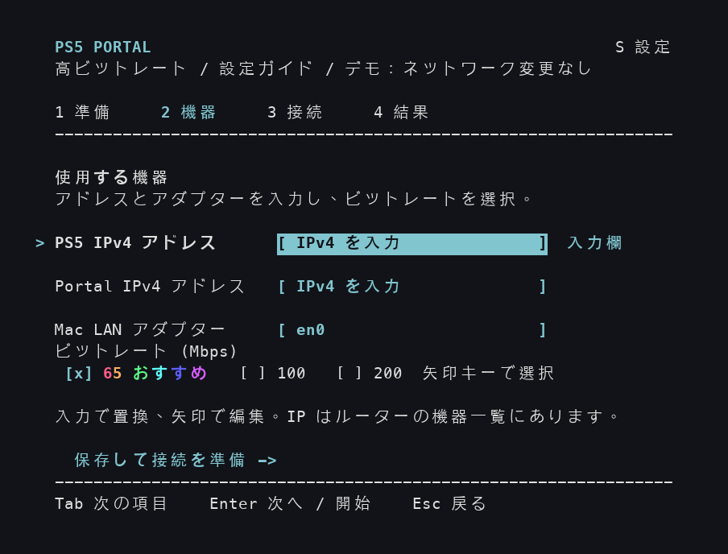
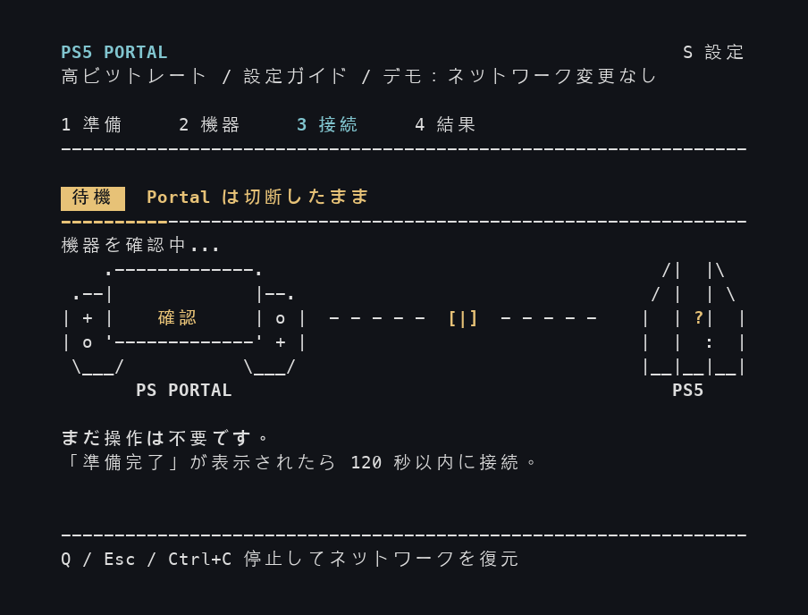
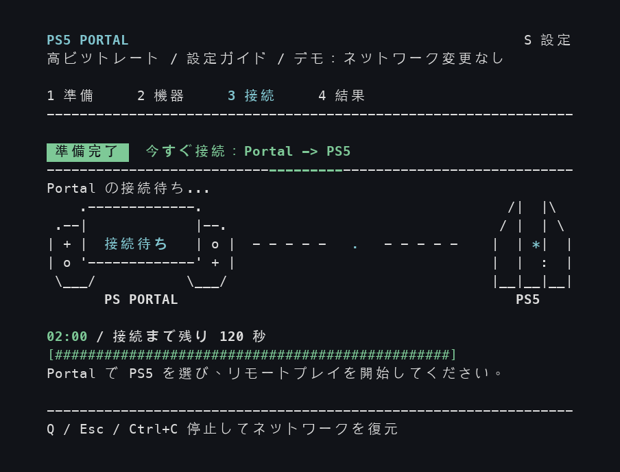
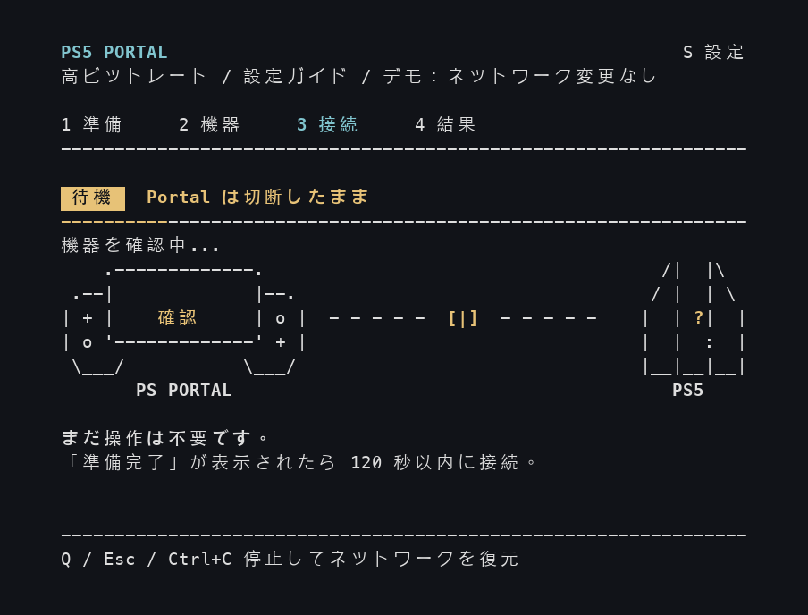
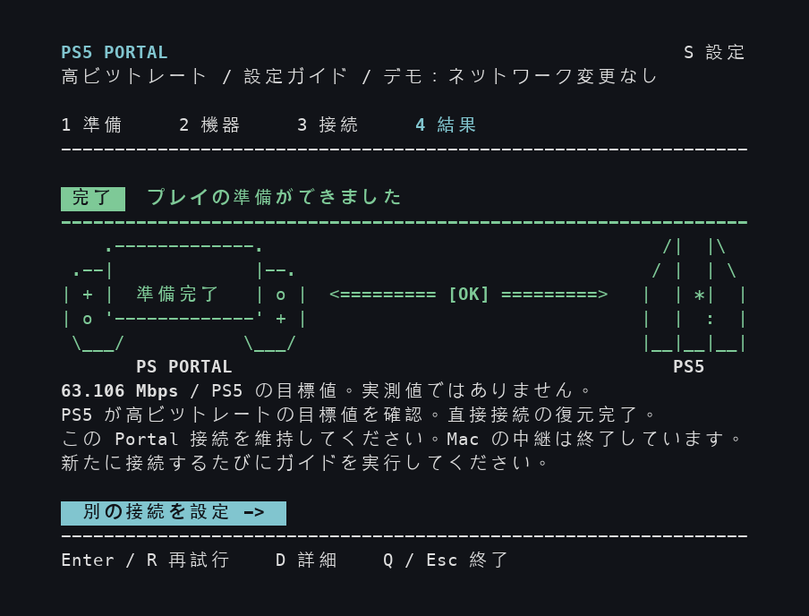
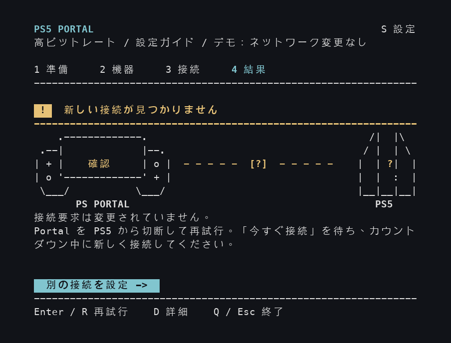
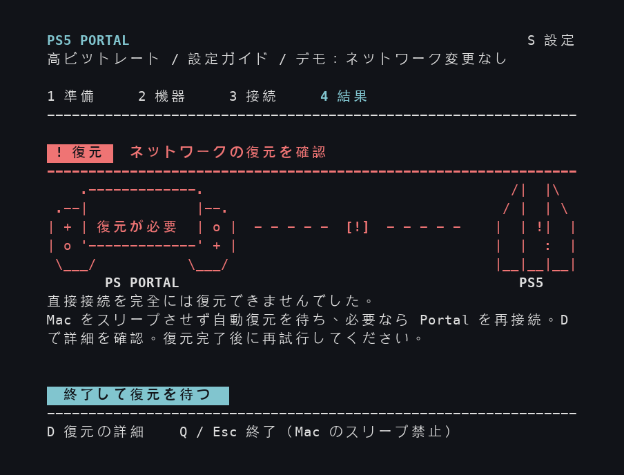

## 謝辞

元のビットレート調整手法は **[@atameric](https://github.com/atameric)** と [ps5-portal-high-bitrate](https://github.com/atameric/ps5-portal-high-bitrate) に由来します。[原作者を支援](https://buymeacoffee.com/atameric)できます。

[MIT](LICENSE) ライセンスに基づいて公開されています。独立したコミュニティソフトウェアであり、Sony または PlayStation とは提携していません。

# Better Portal

**macOS セキュリティプレビュー：**ZIP 版と Homebrew 版の起動ツールは、sudo を使わず署名済み macOS ヘルパーを利用します。署名済みインストーラと実機検証は未完了のため、現在はデモのみ利用できます。[設定・削除・公開状況](docs/macos-authorization.md)をご覧ください。

[English](README.md) · [简体中文](README.zh-CN.md) · **日本語** · [한국어](README.ko.md) · [Español](README.es.md) · [Français](README.fr.md)

PlayStation Portal で自分の PS5 を遊ぶときに、より高い画質を目指すビットレートを設定できます。Mac の設定ガイドが、画面ごとに操作を案内します。

[インストールと起動](#get-started) · [初めて使うとき](#first-session) · [機器のアドレスを調べる](#find-device-addresses) · [困ったとき](#questions-and-fixes)

## Homebrew でインストール・更新（Mac）

[Homebrew](https://brew.sh) を使っている場合は、ターミナルで次の2行を順に実行します。Python と必要なパッケージもインストールされます：

```sh
brew tap wchwawa/better-portal https://github.com/wchwawa/better-portal
brew install --HEAD wchwawa/better-portal/better-portal
```

**`better-portal`** で起動します。更新前にウィザードを閉じ、**`better-portal update`** を実行してください。アドレス、言語、ビットレート、レポートはユーザーフォルダに保持されます。最新の `main` ブランチを使用しますが、Python を sudo で実行しません。実際の接続には署名済みヘルパーのインストールと承認が必要です。それまでは `better-portal --demo` を使えます。[詳細と以前の設定の読み込み](docs/homebrew.md)。下記の ZIP インストールも引き続き使えます。

更新後は、インストールされたバージョンと変更内容がターミナルに表示されます。**`better-portal changes`** でオフラインでも再確認できます。見出しは保存した言語で表示され、変更内容は元の英語のコミット説明が使われます。

## Windows で始める

**Windows 11 / Windows 10** でも同じ設定ガイドを使えます。Windows の実機検証は継続中です。詳しくは [Windows ガイド（英語）](WINDOWS.md)をご覧ください。

1. [Python](https://www.python.org/downloads/windows/)（3.10 以降、`py` ランチャー付き）と [Npcap](https://npcap.com/#download) をインストールします。Npcap の WinPcap 互換モードはオフにします。
2. [Better Portal ZIP](https://github.com/wchwawa/better-portal/archive/refs/heads/main.zip) をダウンロードしてすべて展開します。初回だけ **Setup-Windows.cmd** を開き、**Setup complete** を待ちます。
3. **次回から：Start-Windows.cmd** をダブルクリックし、Windows の許可画面で承認します。コマンド入力や別の設定ツールは不要です。
4. 言語と 2 台の IPv4 アドレスを設定し、**← / →** で PC の Wi-Fi / Ethernet アダプターとビットレートを選びます。Portal は切断したまま待ち、**CONNECT NOW** が出たら **120 秒以内**に PS5 へ接続します。

言語、**S** キーの設定、アニメーション、接続段階、結果判定は下の Mac 版と共通です。Windows では **PC LAN アダプター** を選びます。言語・アドレス・ビットレートは保存されます。目標ビットレートの確認後も、Portal の映像・音声・操作を確認してください。

**Mac の場合：**上記の Homebrew、または以下の ZIP 手順を選べます。


## 始める前に

次のものを用意してください。

- **Mac、PS5、PlayStation Portal**。Portal からリモートプレイで自分の PS5 を普段どおり遊べる状態にしてください。
- 3 台とも**自宅の同じルーター**に接続します。Mac と Portal は自宅の Wi-Fi、PS5 は同じ Wi-Fi またはそのルーターにつないだ LAN ケーブルを使えます。ゲスト用 Wi-Fi は避け、Mac で VPN を使っている場合は切断してください。
- インストール時のインターネット接続と、**Mac にログインするときのパスワード**。

これはコミュニティが開発する実験的なツールです。最初は **65 Mbps** を選んでください。ビットレートは、1 秒あたりに送れる映像データの量を表します。上げると細部が見やすくなる場合がありますが、接続が不安定だと映像がカクつくこともあります。

<a id="get-started"></a>

## インストールと起動

以下は ZIP 版のインストール手順です。Homebrew でインストール済みなら **`better-portal`** を実行し、下の「初めて使うとき」へ進んでください。ガイドで Start.command を開くと書かれている箇所では、このコマンドを使います。

インストールは最初の 1 回だけです。ダウンロードしたフォルダーは丸ごと残してください。次回もその中のファイルから起動します。

<a id="install-python"></a>

### A. Python をインストールする

Python は Better Portal を動かすために必要です。コードを書く必要はありません。Python 3.10 以降がすでに入っている場合は B に進めます。

1. [Python 公式の Mac ダウンロードページ](https://www.python.org/downloads/macos/)を開きます。**Stable Releases** で **Python 3.14** のリリースを探し、その下の **macOS installer** をクリックします。Better Portal で動作をテストしているバージョン系列です。
2. ダウンロードした `.pkg` ファイルを開き、**続ける → インストール**と進んで完了させます。
3. Finder で**アプリケーション → Python 3.14**を開き、**Install Certificates.command** をダブルクリックします。`update complete` と表示されたら、そのウインドウを閉じてください。[Python 公式のインストール手順（英語）](https://docs.python.org/3.14/using/mac.html)にも説明があります。

### B. Better Portal をダウンロードして準備する

1. [Better Portal の ZIP をダウンロード](https://github.com/wchwawa/better-portal/archive/refs/heads/main.zip)をクリックします。
2. **Finder**（青い笑顔のアイコン）を開き、**ダウンロード**を選びます。ZIP がまだ展開されていなければダブルクリックし、できた **better-portal-main** フォルダーを開きます。
3. **Setup.command** をダブルクリックします。**ターミナル**という、文字を表示してキーボードで操作するウインドウが開きます。インストールが終わるまで待ちます。
4. **`Setup complete.`** が表示されたら **Return** キーを押し、ウインドウを閉じます。完了ではなくエラーが出た場合は、先に[困ったとき](#questions-and-fixes)を確認してください。

| フォルダー内のファイル | 開くタイミング |
| --- | --- |
| **Setup.command** | 最初のインストール時に 1 回。 |
| **Start.command** | Portal の新しい接続を設定するたび。 |

ほかのファイルはそのまま残します。開いたり編集したりする必要はありません。

### C. 設定ガイドを開く

署名済みヘルパーをインストールして承認した後、同じフォルダーの **Start.command** をダブルクリックします。通常の Mac ユーザー権限で動作します。署名済みインストーラの公開までは、下記のデモコマンドでプレビューしてください。

macOS にファイルの起動を止められた場合は、[「macOS がファイルを開かない」](#macos-blocked)を参照してください。ウインドウを広げるように表示されたら、ターミナルの角をドラッグして大きくします。

<a id="first-session"></a>

## 初めて使うとき

**設定ガイドは Mac のキーボードで操作します。** 最初にターミナルの中を 1 回クリックし、キー入力が届くようにしてください。色付きのボタンもキーで選びます。Mac の **Return** は、画面に書かれている **Enter** と同じキーです。

| キー | 操作 |
| --- | --- |
| **Return / Enter** | 選択を確定する、次の入力欄に移る、または選択中のボタンを実行する。 |
| **Tab** または **↑ / ↓** | 機器の入力欄を移動する。`>` が現在の行を示します。 |
| **← / →** | ビットレートの行で設定を変える。`[x]` が選択中の項目です。 |
| **S** | 設定を開いて言語を変える。文字キーを 1 回押すだけで、Return は不要です。 |

以下は**実際のアプリをデモモードで動かした画像**です。「デモ」の表示やアドレスは説明用です。**自分の機器のアドレスを入力し、自分の画面のカウントダウンに従ってください。** 画像をクリックすると拡大できます。

### 言語を選ぶ

**↑ / ↓** で **日本語、English、简体中文、한국어、Español、Français** から選び、**Return** を押します。選択は保存されます。最初から準備画面が開く場合は、以前の選択が保存されています。**S** で変更できます。



### 1. 機器を準備する

**Portal** の画面右上から左へスワイプしてクイックメニューを開き、**接続を切断**します。PS5 を起動したままにするため、切断時に接続先の PS5 をレストモードにするオプションはオフにしてください。メニューが見つからない場合は、[Sony のリモートプレイガイド（英語）](https://www.playstation.com/en-nz/support/hardware/playstation-remote-play-on-psportal/)を参照できます。

**Portal の電源と Wi-Fi 接続は維持してください。** 終了するのは現在のプレイ接続だけです。Mac もスリープさせず、ノート型なら画面を閉じないでください。

**Mac** に戻り、黄色の注意書きを読んだら **Return** で機器の画面に進みます。



### 2. 2 つのアドレスを入力し、65 Mbps を選ぶ

<a id="find-device-addresses"></a>

**まず、PS5 と Portal それぞれのアドレスを調べます。** IPv4 アドレスは、自宅のネットワークで機器を識別する番号です。数字の組が 4 つあり、間をピリオドで区切ります。2 台の番号は異なります。

1. 普段**自宅のルーターや Wi-Fi** を管理しているアプリまたは管理ページを開きます。名称はルーターやインターネット事業者によって異なります。
2. **デバイス、接続機器、クライアント**（Clients）などの一覧を探します。**PS5** の項目を開いて **IP アドレス / IPv4 アドレス**を控え、**PlayStation Portal** についても同じように調べます。
3. 2 つの番号を手元に置いてください。必要なのは機器のアドレスです。ルーター自身のアドレス、MAC アドレス、速度テストの結果とは異なります。**このガイドの `192.168.1.20` や `192.168.1.30` は写さないでください。**

図付きの例として、[TP-Link Tether の手順（英語）](https://www.tp-link.com/us/support/faq/2611/)は **Local Device → Clients → 対象の機器**の順です。[ASUS の機器一覧ガイド（英語）](https://www.asus.com/us/support/faq/1005513/)もあります。管理ページの開き方や機器の見分け方が分からない場合は、自宅の Wi-Fi を設定した人やインターネット事業者に、この 2 台のローカルアドレスを確認してから進んでください。

**Mac の画面を上から順に入力します。**

| 行 | 操作したら Return を押す |
| --- | --- |
| **PS5 IPv4 アドレス** | 調べた PS5 のアドレスを入力します。 |
| **Portal IPv4 アドレス** | 調べた Portal のアドレスを入力します。 |
| **Mac LAN アダプター** | Mac のネットワークアダプター名です。通常は `en0` などの表示済みの値を使います。空欄や別のアダプターの場合は[こちら](#mac-adapter)で確認します。 |
| **ビットレート (Mbps)** | 初回は **65 おすすめ**のままにします。 |
| **保存して接続を準備** | Return で準備を始めます。Portal はまだ切断したままにしてください。 |

入力欄へ移動した直後に文字を打つと、以前の内容が置き換わります。間違えたら **↑** で戻って修正できます。アドレスとビットレートは次回のために保存されます。



<details>
<summary>入力順序と 65 Mbps の虹色アニメーションを見る</summary>

この例ではサンプルのアドレスを入力し、アダプターと 65 Mbps をそのまま使って開始ボタンまで移動します。動画は繰り返しますが、実際の画面では入力した内容が残ります。


</details>

<details>
<summary>100 Mbps や 200 Mbps はいつ使う？</summary>

ビットレートの行で **← / →** または**スペース**を押すと切り替わります。65 Mbps で安定して遊べたら **100 Mbps** を試せます。**200 Mbps** は実験的な設定で、カクつきが増える場合があります。同じゲーム場面で比べてください。高い数値が常に良いとは限りません。

</details>

### 3. Mac の準備を待ち、その後 Portal で接続する

**まず「待機」と出たら、そのまま待ちます。** Mac が機器を確認して接続の準備をしている間、Portal は切断したままにしてください。



**次に「準備完了 / 今すぐ接続」と出たら、Portal を操作します。** Portal のリモートプレイのホーム画面で自分の PS5 を選び、普段どおり接続します。Mac の **02:00** から始まるカウントダウンが終わるまで、**120 秒**あります。この間、アプリは**あなたが Portal で接続を始めるのを待っています**。



Portal が接続できたら、そのまま接続を維持します。Mac の**結果画面**が出るまでウインドウを閉じないでください。時間切れになった場合は、結果に表示される再試行の案内に従います。

途中で止めるには Mac で **Q** を押し、結果を待ちます。ネットワークの復元中は Mac をスリープさせないでください。

<details>
<summary>待ち時間を短縮した接続デモを見る</summary>

このデモは「待機」から「今すぐ接続」、接続の確認、成功結果までを繰り返します。出来事はシミュレーションで、待ち時間も短縮しています。**実際の操作では、自分のアプリのカウントダウンに従ってください。**



</details>

### 4. 目標ビットレートを確認し、Portal をチェックする

緑色の**目標ビットレートを確認**と **`[OK]`** は、PS5 が高い目標値を報告したことを示します。**プレイする前に Portal の映像・音声・操作を確認してください。** ツールは実際の再生や機器のアドレス対応表を検証できません。黒画面が続く場合は Better Portal を使わずに通常通り切断・再接続し、問題を報告してください。復元が終わるまで Mac を起動したままにします。**Q** で終了し、`Press Enter to close` が出たら Return を押してウインドウを閉じます。

画像とアニメーションは旧版で、この結果は**プレイの準備ができました**と表示されます。この表示も目標値だけを確認したものです。



**63.106 Mbps** などの数値は PS5 が報告した目標値で、**実際に転送された映像のビットレートを測った値ではありません**。Mac がこの接続のデータを中継する必要はなくなっています。

**次に Portal を切断したり電源を切ったりした後は：** **Start.command** を開き、4 つの手順をもう一度行います。保存したアドレスは自動入力されます。ネットワークが変わった場合は確認し直してください。

## 別の結果が出た場合

以下は**それぞれ別の結果**です。成功後に順番に通過する画面ではありません。

| Mac のメッセージ | 次にすること |
| --- | --- |
| **新しい接続が見つかりません / 対応する接続要求が見つかりません** | Portal を PS5 から切断し、**Return** で再試行します。次の「今すぐ接続」を待ってから Portal で接続します。 |
| **高ビットレートの目標値を未確認 / 目標値は受信、検証は未完了** | **D** で詳細を確認します。ネットワークの復元後、普段どおり接続するか 65 Mbps で再試行できます。 |
| **実行を停止しました** | 復元状況を読んでください。復元済みなら Return で再試行、Q で終了できます。 |
| **ネットワークの復元を確認** | Mac をスリープさせず、**D** で復元の詳細を確認します。復元が完了してから次の試行を始めてください。 |

<details>
<summary>再試行と復元の画面を別々に見る</summary>

**新しい接続が見つからない場合**：再試行し、「今すぐ接続」が出てから Portal で新しく接続します。



**復元の確認が必要な場合**：Mac を起動したままにして、D で詳細と対処方法を確認します。



[結果のアニメーション](docs/images/result-ja.gif)では、比較用に複数の結果をシミュレーションして順番に表示しています。1 回の成功した接続で、これらすべてを通るわけではありません。

</details>

## 使用中に言語を変える

**S** を押し、**方向キー**で言語を選び、**Enter、Esc、S** のいずれかで戻ります。変更はすぐ反映され、保存されます。Esc はパネルを閉じるだけで、変更を取り消しません。入力内容と現在の手順は維持されます。

接続中に設定を開いても、カウントダウンは進み続けます。**Q** で試行を停止できます。ネットワークの復元が始まると設定パネルは閉じます。

<details>
<summary>その場での言語切り替えと各言語の画面を見る</summary>


</details>

<a id="questions-and-fixes"></a>

## 困ったとき

<a id="macos-blocked"></a>

**macOS がファイルを開かず、開発元を確認できない、または Apple で確認できないと表示します。**

このリポジトリからダウンロードしたファイルを一度開こうとした後、**Apple メニュー → システム設定 → プライバシーとセキュリティ**を開きます。該当ファイルの通知を探し、入手元を信頼できることを確認して**このまま開く**を選び、開く操作を確認します。[Apple の図付き説明（英語）](https://support.apple.com/en-us/102445)も参照できます。「コンピュータに損害を与える」という警告は別のケースです。その場合は停止し、該当する Apple の案内に従ってください。

**Setup で完了と出ず、Python や証明書のエラーになります。**

[A. Python のインストール](#install-python)を、**Install Certificates.command** も含めて完了させます。失敗したウインドウを閉じて **Setup.command** を再度開いてください。まだ失敗する場合は、問い合わせ時にエラー文を添えてください。

**接続ヘルパーが利用できない、または承認されていません。**

署名済みパッケージの公開後に Better Portal をインストールし、アプリでヘルパーを有効にしてシステム設定で承認してください。それまではデモモードを使用できます。ウィザードは sudo を要求しません。

**文字が切れる、またはウインドウを広げるように表示します。**

ターミナルの角をドラッグして広げます。最低 72 列 × 24 行の表示領域が必要です。十分な大きさになると表示を再開します。

**機器が応答しない、または映像がカクつきます。**

PS5 と Portal を起動したままにし、現在のアドレスと自宅の Wi-Fi 接続を確認します。カクつく場合は 65 Mbps を試すか、Portal を切断し、Better Portal を使わず普段どおり再接続してください。

**Mac のパスワードは保存されますか？**

保存しません。認証は macOS が管理します。同じ設定ガイドを開いたまま再試行する場合、再入力は求められません。

**どこで相談できますか？**

[Issue を作成](https://github.com/wchwawa/better-portal/issues)し、止まった手順、画面のメッセージ、macOS と Portal のバージョン、選んだビットレートを記載してください。スクリーンショットの機器アドレスは隠してから共有します。未加工のレポートやパケットキャプチャには私的なネットワーク情報が含まれる場合があるため、手元に保管してください。

<a id="terminal-help"></a>

<details>
<summary>ターミナルの使い方：フォルダーを開く、デモを見る、Python が見つからない場合</summary>

ターミナルを手動で開くには、**Command（⌘）+ スペース**を押し、**ターミナル**と入力して Return を押します。

1. `cd` と入力し、**半角スペースを 1 つ**入れます。
2. Finder の **better-portal-main フォルダー**をターミナルへドラッグし、Return を押します。これで作業に使うフォルダーを指定できます。
3. 下のコマンドを**1 行ずつ**コピーして貼り付け、Return を押します。コマンドの文字だけをコピーしてください。

Start が `.venv/bin/python` を見つけられない場合は、このフォルダーで先にセットアップを実行します。

```sh
./Setup.command
```

実際の接続を設定するには、次を実行します。

```sh
./Start.command
```

セットアップ後に**画面だけを試す**には、次を実行します。

```sh
.venv/bin/python portal_tui.py --demo
```

**アニメーションなしで画面を試す**には、次を実行します。

```sh
.venv/bin/python portal_tui.py --demo --no-animations
```

この 2 つのデモコマンドは、実機なしで接続をシミュレーションします。管理者パスワードは不要で、ネットワークを変更せず、設定も保存しません。実際に接続するときはデモを終了してから Start.command を開いてください。

</details>

<a id="mac-adapter"></a>

<details>
<summary>Mac LAN アダプターが空欄、または USB / 有線アダプターを使っている場合</summary>

ここに入れるのは `en0` などの名前です。Wi-Fi 名や IP アドレスではありません。上の説明でターミナルを開き、次を実行します。

```sh
networksetup -listallhardwareports
```

Wi-Fi を使う場合は **Hardware Port: Wi-Fi** の段落を探し、**Device:** の後ろの名前を使います。有線の場合は、接続している Ethernet アダプターの段落を確認します。その Device 名を設定ガイドに入力してください。どれを使っているか分からない場合は、問い合わせ時にその点も伝えてください。

</details>

<details>
<summary>Git とターミナルを使い慣れている場合</summary>

```sh
git clone https://github.com/wchwawa/better-portal.git
cd better-portal
./Setup.command
./Start.command
```

</details>

**Linux の場合：**元のプロジェクトの [Linux / 自動設定ガイド](https://github.com/atameric/ps5-portal-high-bitrate/blob/main/AUTOMATION.md)をご覧ください。
