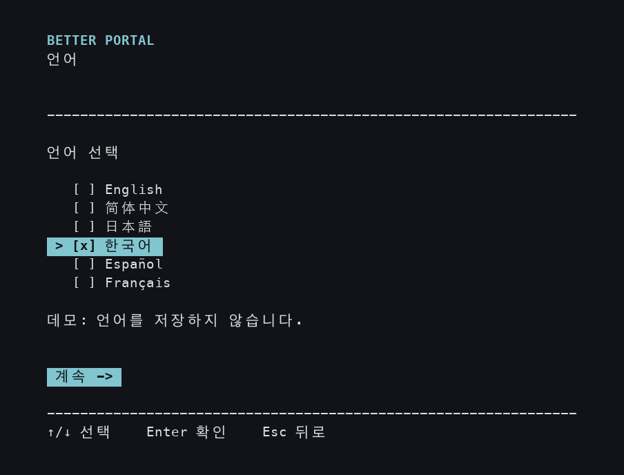
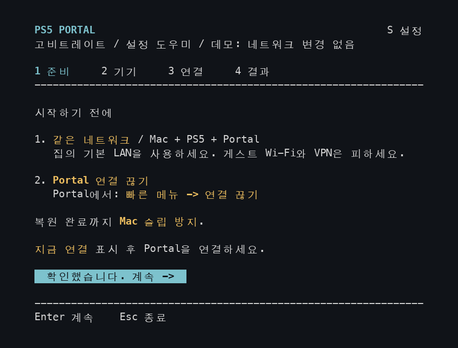
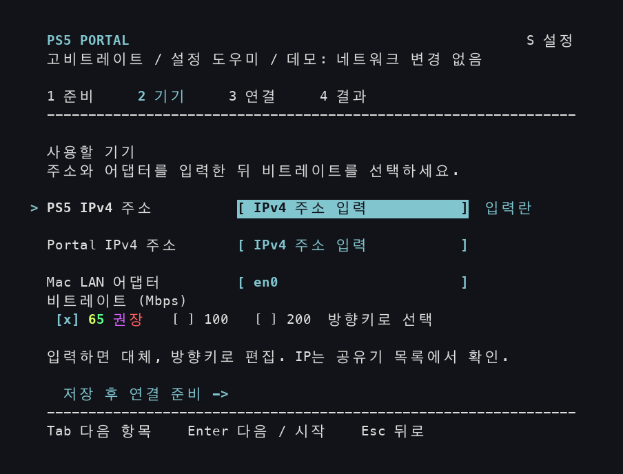
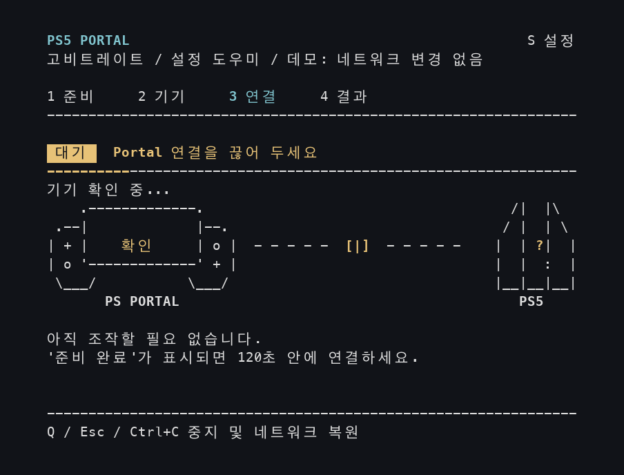
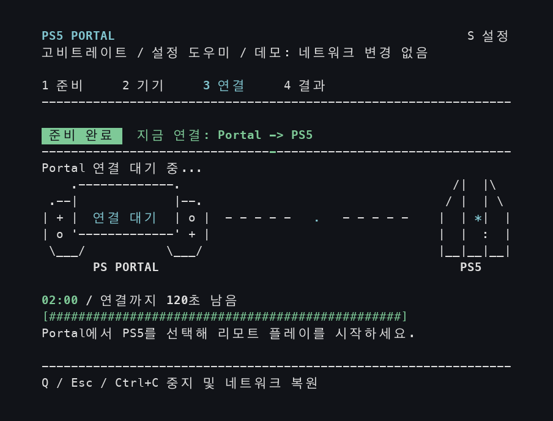
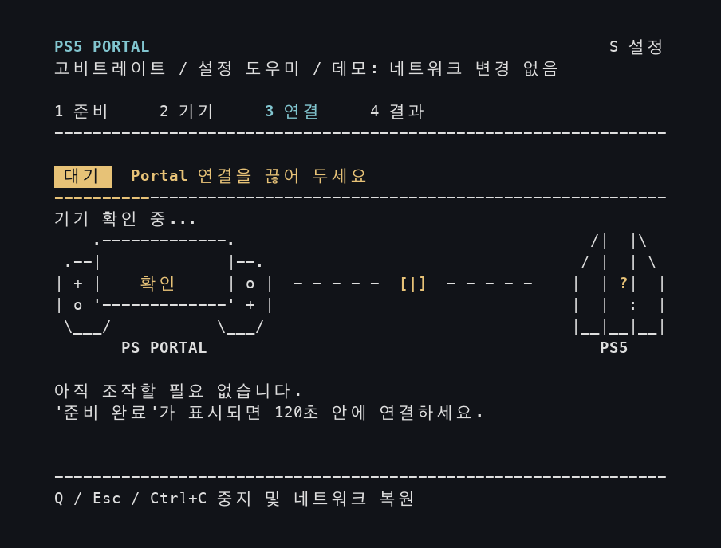
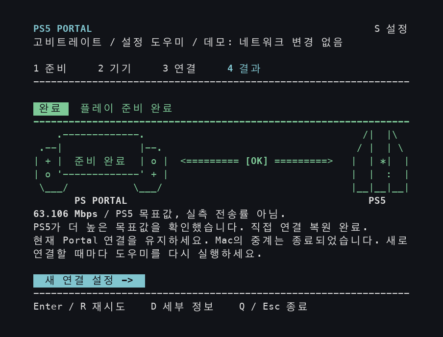
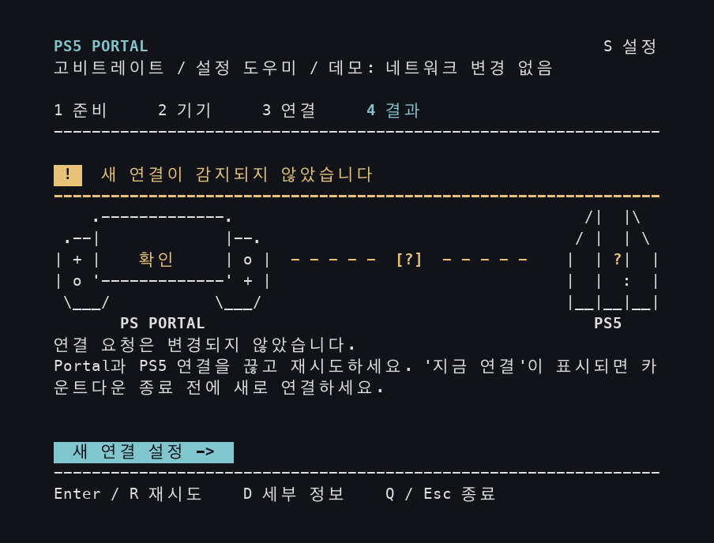
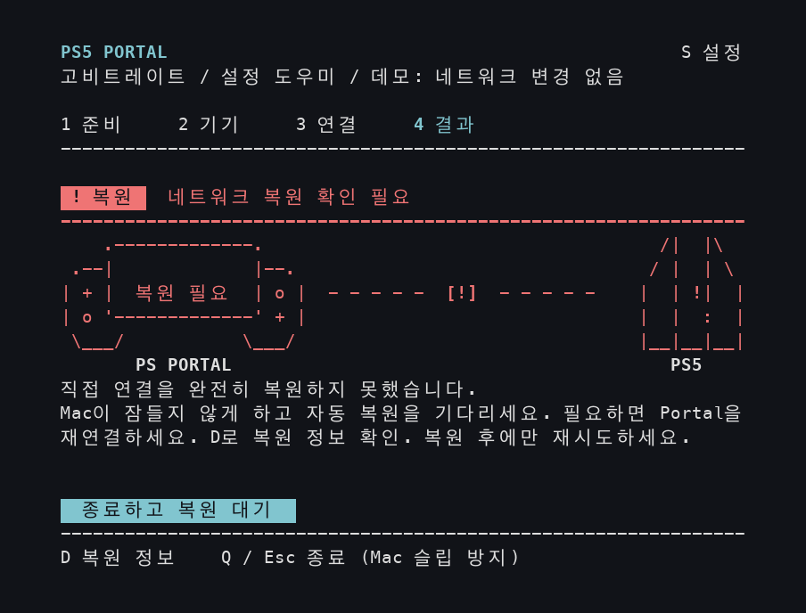

## 감사의 말

원래의 비트레이트 조정 방식은 [**@atameric**](https://github.com/atameric)과 [ps5-portal-high-bitrate](https://github.com/atameric/ps5-portal-high-bitrate)에서 비롯되었습니다. [원작자를 후원](https://buymeacoffee.com/atameric)할 수 있습니다.

[MIT](LICENSE) 라이선스에 따라 배포됩니다. 독립적인 커뮤니티 소프트웨어이며 Sony 또는 PlayStation과 제휴하지 않습니다.

# Better Portal

[English](README.md) · [简体中文](README.zh-CN.md) · [日本語](README.ja.md) · **한국어** · [Español](README.es.md) · [Français](README.fr.md)

PlayStation Portal로 자신의 PS5를 플레이할 때 더 높은 화질을 위한 비트레이트 목표를 설정하세요. Mac의 설정 도우미가 화면마다 필요한 조작을 안내합니다.

[설치 및 실행](#get-started) · [처음 사용하기](#first-session) · [기기 주소 찾기](#find-device-addresses) · [문제 해결](#questions-and-fixes)

## Homebrew로 설치 및 업데이트（Mac）

[Homebrew](https://brew.sh)를 사용한다면 터미널에서 다음 두 명령을 차례대로 실행하세요. Python과 필요한 패키지도 자동으로 설치됩니다:

```sh
brew tap wchwawa/better-portal https://github.com/wchwawa/better-portal
brew install --HEAD wchwawa/better-portal/better-portal
```

**`better-portal`**로 실행합니다. 업데이트 전 마법사를 닫고 **`better-portal update`**를 실행하세요. 주소, 언어, 비트레이트와 보고서는 사용자 폴더에 유지됩니다. 최신 `main` 브랜치를 사용하며 실제 연결 시에는 여전히 Mac 암호를 요청합니다. [자세한 안내 및 이전 설정 가져오기](docs/homebrew.md). 아래 ZIP 설치 방법도 계속 사용할 수 있습니다.

## Windows 빠른 시작

**Windows 11과 Windows 10**에서도 같은 설정 가이드를 사용할 수 있습니다. Windows 실기기 검증은 진행 중입니다. 자세한 내용은 [Windows 가이드(영어)](WINDOWS.md)를 확인하세요.

1. [Python](https://www.python.org/downloads/windows/)(3.10 이상, `py` 실행기 포함)과 [Npcap](https://npcap.com/#download)을 설치하세요. Npcap의 WinPcap 호환 모드는 선택하지 마세요.
2. [Better Portal ZIP](https://github.com/wchwawa/better-portal/archive/refs/heads/main.zip)을 내려받아 전체 압축을 푸세요. 처음에만 **Setup-Windows.cmd**를 열고 **Setup complete**를 기다리세요.
3. **다음부터는 Start-Windows.cmd**를 더블 클릭하고 Windows 권한 요청을 허용하세요. 명령 입력이나 별도의 설정 도구는 필요 없습니다.
4. 언어와 두 기기의 IPv4 주소를 입력하고 **← / →**로 PC의 Wi-Fi / 이더넷 어댑터와 비트레이트를 고르세요. Portal 연결을 끊은 채 기다리다가 **CONNECT NOW**가 나오면 **120초 이내**에 PS5에 연결하세요.

언어, **S** 설정 단축키, 애니메이션, 연결 단계와 결과 판단은 아래 Mac 버전과 같습니다. Windows에서는 **PC LAN 어댑터**를 선택합니다. 언어, 주소와 비트레이트가 저장됩니다. 목표 비트레이트가 확인되어도 Portal의 화면, 소리와 조작을 확인하세요.

**Mac을 사용하나요?** 위의 Homebrew 방법이나 아래 ZIP 설치 방법을 선택하세요.


## 시작하기 전에

다음을 준비하세요.

- **Mac, PS5, PlayStation Portal**. Portal에서 리모트 플레이로 자신의 PS5 게임을 이미 정상적으로 플레이할 수 있어야 합니다.
- 세 기기를 **집의 같은 공유기**에 연결하세요. Mac과 Portal은 집의 Wi-Fi를, PS5는 같은 Wi-Fi 또는 해당 공유기에 연결한 랜 케이블을 사용할 수 있습니다. 게스트 Wi-Fi는 피하고, Mac에서 VPN을 사용 중이라면 연결을 끊으세요.
- 설치할 때 사용할 인터넷 연결과 **Mac에 로그인할 때 쓰는 암호**.

이 프로그램은 커뮤니티가 개발하는 실험적 도구입니다. 처음에는 **65 Mbps**를 선택하세요. 비트레이트는 1초 동안 보낼 수 있는 영상 데이터의 양입니다. 높이면 세부 묘사가 나아질 수 있지만, 연결이 불안정하면 끊김이 생길 수도 있습니다.

<a id="get-started"></a>

## 설치 및 실행

아래는 ZIP 설치 단계입니다. Homebrew로 설치했다면 **`better-portal`**을 실행하고 아래의 첫 사용 안내로 이동하세요. 안내에서 Start.command를 열라고 하면 대신 이 명령을 실행하세요.

설치는 처음 한 번만 하면 됩니다. 내려받은 폴더 전체를 보관하세요. 다음에도 그 안의 파일로 실행합니다.

<a id="install-python"></a>

### A. Python 설치하기

Python은 Better Portal을 실행하는 프로그램입니다. 코드를 작성할 필요는 없습니다. Python 3.10 이상이 이미 설치되어 있다면 B로 넘어가세요.

1. [Python 공식 Mac 다운로드 페이지](https://www.python.org/downloads/macos/)를 엽니다. **Stable Releases**에서 **Python 3.14** 버전을 찾아 그 아래의 **macOS installer**를 클릭하세요. Better Portal에서 테스트한 버전 계열입니다.
2. 내려받은 `.pkg` 파일을 열고 **계속 → 설치**를 따라 설치를 마칩니다.
3. Finder에서 **응용 프로그램 → Python 3.14**를 열고 **Install Certificates.command**를 더블 클릭합니다. `update complete`가 표시되면 창을 닫으세요. [Python 공식 설치 안내(영어)](https://docs.python.org/3.14/using/mac.html)에도 이 단계가 나와 있습니다.

### B. Better Portal 내려받고 준비하기

1. [Better Portal ZIP 다운로드](https://github.com/wchwawa/better-portal/archive/refs/heads/main.zip)를 클릭합니다.
2. **Finder**(파란색 웃는 얼굴 아이콘)를 열고 **다운로드**로 이동합니다. ZIP이 아직 풀리지 않았다면 더블 클릭하고, 생성된 **better-portal-main** 폴더를 엽니다.
3. **Setup.command**를 더블 클릭합니다. 글자를 표시하고 키보드로 조작하는 **터미널** 창이 열립니다. 설치가 끝날 때까지 기다리세요.
4. `Setup complete.`가 표시되면 **Return**을 누른 뒤 창을 닫습니다. 완료 대신 오류가 표시되면 먼저 [문제 해결](#questions-and-fixes)을 확인하세요.

| 폴더 안의 파일 | 실행할 때 |
| --- | --- |
| **Setup.command** | 처음 설치할 때 한 번. |
| **Start.command** | Portal의 새 연결을 설정할 때마다. |

나머지 파일은 그대로 두세요. 열거나 수정할 필요가 없습니다.

### C. 설정 도우미 열기

같은 폴더에서 **Start.command**를 더블 클릭하세요. `Password:`가 표시되면 **Mac 로그인 암호**를 입력하고 **Return**을 누릅니다. **입력할 때 글자나 점이 나타나지 않는 것이 정상입니다.** `Sorry, try again`이 나오면 암호를 다시 입력하세요.

macOS가 실행을 차단하면 [“macOS가 파일을 열지 않습니다”](#macos-blocked)를 참고하세요. 창을 넓히라는 안내가 나오면 터미널 창 모서리를 끌어 크게 만드세요.

<a id="first-session"></a>

## 처음 사용하기

**설정 도우미는 Mac 키보드로 조작합니다.** 먼저 터미널 창 안을 한 번 클릭해 키 입력을 받을 수 있게 하세요. 색상이 있는 버튼도 키보드로 선택합니다. Mac의 **Return**은 화면에 쓰인 **Enter**와 같은 키입니다.

| 키 | 기능 |
| --- | --- |
| **Return / Enter** | 선택을 확인하거나 다음 입력란으로 이동하거나 선택된 버튼을 실행합니다. |
| **Tab** 또는 **↑ / ↓** | 기기 입력란 사이를 이동합니다. `>`가 현재 행을 가리킵니다. |
| **← / →** | 비트레이트 행에서 값을 바꿉니다. `[x]`가 선택한 항목입니다. |
| **S** | 설정을 열어 언어를 바꿉니다. 문자 키를 한 번 누르면 되며 Return은 필요 없습니다. |

아래 이미지는 **실제 프로그램을 데모 모드로 실행한 화면**입니다. ‘데모’ 표시와 주소는 설명용입니다. **자신의 기기 주소를 입력하고, 실제 창의 카운트다운에 맞춰 조작하세요.** 이미지를 클릭하면 크게 볼 수 있습니다.

### 언어 선택하기

**↑ / ↓**로 **한국어, English, 简体中文, 日本語, Español, Français** 중 하나를 선택하고 **Return**을 누릅니다. 선택한 언어는 저장됩니다. 바로 준비 화면이 나오면 이전 선택이 저장된 상태입니다. **S**로 바꿀 수 있습니다.



### 1. 기기 준비하기

**Portal** 화면 오른쪽 위에서 왼쪽으로 밀어 빠른 메뉴를 열고 **연결 끊기**를 선택합니다. PS5가 계속 켜져 있도록, 연결을 끊을 때 PS5를 대기 모드로 전환하는 옵션은 꺼 두세요. 메뉴를 찾기 어렵다면 [Sony 리모트 플레이 안내(영어)](https://www.playstation.com/en-nz/support/hardware/playstation-remote-play-on-psportal/)를 참고하세요.

**Portal 전원과 Wi-Fi 연결은 유지하세요.** 현재 플레이 연결만 끝내는 것입니다. Mac도 잠들지 않게 하고, 노트북이라면 덮개를 열어 두세요.

**Mac**에서 노란색 안내를 읽고 **Return**을 눌러 기기 화면으로 이동합니다.



### 2. 두 주소를 입력하고 65 Mbps 유지하기

<a id="find-device-addresses"></a>

**먼저 PS5와 Portal 각각의 주소를 찾으세요.** IPv4 주소는 집의 네트워크에서 기기를 구분하는 번호입니다. 숫자 네 묶음을 마침표로 구분하며, 두 기기의 주소는 서로 다릅니다.

1. 평소 **집의 공유기나 Wi-Fi**를 관리하는 앱 또는 관리 페이지를 엽니다. 이름은 공유기 제조사나 인터넷 제공업체에 따라 다릅니다.
2. **기기, 연결된 기기, 클라이언트(Clients)** 같은 목록을 찾습니다. **PS5** 항목을 열어 **IP 주소 / IPv4 주소**를 적고, **PlayStation Portal** 주소도 같은 방법으로 적습니다.
3. 두 주소를 옆에 준비하세요. 공유기 자체의 주소, MAC 주소, 인터넷 속도 측정값이 아닌 기기 주소가 필요합니다. **이 안내의 `192.168.1.20`이나 `192.168.1.30`을 그대로 입력하지 마세요.**

그림이 있는 예로, [TP-Link Tether 안내(영어)](https://www.tp-link.com/us/support/faq/2611/)는 **Local Device → Clients → 해당 기기** 순서입니다. [ASUS 기기 목록 안내(영어)](https://www.asus.com/us/support/faq/1005513/)도 있습니다. 관리 페이지를 여는 방법이나 기기를 구분하는 방법을 모르면, 집의 Wi-Fi를 설정한 사람이나 인터넷 제공업체에 두 기기의 로컬 주소를 확인한 뒤 진행하세요.

**이제 Mac 화면에서 위에서 아래로 입력하세요.**

| 행 | 이 작업을 한 뒤 Return 누르기 |
| --- | --- |
| **PS5 IPv4 주소** | 찾아 둔 PS5 주소를 입력합니다. |
| **Portal IPv4 주소** | 찾아 둔 Portal 주소를 입력합니다. |
| **Mac LAN 어댑터** | Mac의 네트워크 어댑터 이름입니다. 보통 `en0`처럼 제안된 값을 유지합니다. 비어 있거나 다른 어댑터를 쓴다면 [여기](#mac-adapter)에서 확인하세요. |
| **비트레이트 (Mbps)** | 처음에는 **65 권장**을 선택한 상태로 둡니다. |
| **저장 후 연결 준비** | Return으로 준비를 시작합니다. Portal은 아직 연결하지 마세요. |

입력란으로 이동한 직후 글자를 입력하면 이전 값이 바뀝니다. 실수하면 **↑**로 돌아가 수정하세요. 주소와 비트레이트는 다음 실행을 위해 저장됩니다.



<details>
<summary>입력 순서와 65 Mbps 무지개 애니메이션 보기</summary>

이 예시는 샘플 주소를 입력하고, 어댑터와 65 Mbps를 유지한 뒤 시작 버튼으로 이동합니다. 동영상은 반복되지만 실제 창에서는 입력한 내용이 그대로 남습니다.


</details>

<details>
<summary>100 또는 200 Mbps는 언제 사용하나요?</summary>

비트레이트 행에서 **← / →** 또는 **스페이스**로 바꿀 수 있습니다. 65 Mbps로 안정적으로 플레이한 뒤 **100 Mbps**를 시도하세요. **200 Mbps**는 실험용이며 끊김을 늘릴 수 있습니다. 같은 게임 장면으로 비교하세요. 값이 높다고 항상 더 좋은 것은 아닙니다.

</details>

### 3. Mac의 준비를 기다린 뒤 Portal에서 연결하기

**먼저 ‘대기’가 나오면 기다리세요.** Mac이 기기를 확인하고 연결을 준비하는 동안 Portal은 연결을 끊은 상태로 둡니다.



**다음으로 ‘준비 완료 / 지금 연결’이 나오면 Portal을 조작하세요.** Portal의 리모트 플레이 홈 화면에서 자신의 PS5를 선택해 평소처럼 연결합니다. Mac의 **02:00**에서 시작하는 카운트다운 동안 **120초**가 주어집니다. 프로그램은 이때 **사용자가 Portal에서 직접 연결을 시작하기를 기다립니다**.



Portal이 연결되면 연결을 유지하세요. Mac에 **결과 화면**이 나올 때까지 창을 닫지 마세요. 시간이 끝나면 결과의 재시도 안내를 따릅니다.

도중에 멈추려면 Mac에서 **Q**를 누르고 결과를 기다리세요. 네트워크 복원 중에는 Mac이 잠들지 않게 하세요.

<details>
<summary>대기 시간을 줄인 연결 데모 보기</summary>

이 데모는 ‘대기’, ‘지금 연결’, 연결 확인, 성공 결과를 반복해서 보여 줍니다. 실제 연결이 아닌 시뮬레이션이며 대기 시간을 줄였습니다. **실제 사용 시에는 자신의 앱에 표시되는 카운트다운을 따르세요.**



</details>

### 4. 목표 비트레이트를 확인한 뒤 Portal 점검하기

녹색 **목표 비트레이트 확인됨**과 **`[OK]`**는 PS5가 더 높은 목표값을 보고했다는 뜻입니다. **플레이하기 전에 Portal의 화면·소리·조작을 확인하세요.** 도구는 실제 재생이나 기기의 주소 매핑을 검증할 수 없습니다. 검은 화면이 계속되면 Better Portal 없이 일반 연결로 끊었다가 다시 연결하고 문제를 알려 주세요. 복원이 끝날 때까지 Mac을 깨어 있게 유지하세요. **Q**로 종료하고 `Press Enter to close`가 나오면 Return을 눌러 창을 닫으세요.

이미지와 애니메이션은 이전 버전으로, 이 결과가 **플레이 준비 완료**로 표시됩니다. 이 메시지도 목표값만 확인한 것입니다.



**63.106 Mbps** 같은 값은 PS5가 보고한 목표값이며, **실제로 전송되는 영상 비트레이트를 측정한 값이 아닙니다**. Mac은 더 이상 이 연결의 데이터를 중계할 필요가 없습니다.

**다음에 Portal 연결을 끊거나 전원을 끈 후에는:** **Start.command**를 다시 열어 네 단계를 반복하세요. 저장된 주소는 자동으로 채워집니다. 네트워크가 바뀌었다면 다시 확인하세요.

## 다른 결과가 나왔다면

아래 항목은 **서로 다른 결과**입니다. 성공한 다음 차례대로 기다려야 하는 단계가 아닙니다.

| Mac의 메시지 | 다음에 할 일 |
| --- | --- |
| **새 연결이 감지되지 않았습니다 / 호환되는 연결 요청 없음** | Portal과 PS5의 연결을 끊고 **Return**으로 재시도하세요. 다음 ‘지금 연결’ 표시 후 Portal에서 연결하세요. |
| **높은 목표값이 확인되지 않았습니다 / 목표값 수신, 검증 미완료** | **D**로 세부 정보를 봅니다. 네트워크 복원 후 평소처럼 다시 연결하거나 65 Mbps로 재시도하세요. |
| **시도 중지됨** | 복원 상태를 읽으세요. 복원되었다면 Return으로 재시도하거나 Q로 종료할 수 있습니다. |
| **네트워크 복원 확인 필요** | Mac이 잠들지 않게 하고 **D**로 복원 정보를 확인하세요. 복원이 끝난 뒤에 다음 시도를 시작하세요. |

<details>
<summary>재시도와 복원 안내 화면을 따로 보기</summary>

**새 연결이 없는 경우:** 재시도하고 ‘지금 연결’ 표시 후 Portal에서 새로 연결하세요.



**복원 확인이 필요한 경우:** Mac을 켜 두고 D에서 세부 정보와 안내를 확인하세요.



[결과 애니메이션](docs/images/result-ko.gif)은 비교를 위해 서로 다른 시뮬레이션 결과를 번갈아 보여 줍니다. 한 번의 성공한 연결에서 이 모든 결과가 나오는 것은 아닙니다.

</details>

## 사용 중 언어 바꾸기

**S**를 누르고 **방향키**로 언어를 선택한 뒤 **Enter, Esc 또는 S**로 돌아갑니다. 변경은 즉시 적용되고 저장됩니다. Esc는 창만 닫으며 변경을 취소하지 않습니다. 입력한 내용과 현재 단계는 유지됩니다.

연결 중 설정을 열어도 카운트다운은 계속됩니다. **Q**로 현재 시도를 멈출 수 있습니다. 네트워크 복원이 시작되면 설정 패널이 닫힙니다.

<details>
<summary>즉시 언어 변경과 각 언어의 화면 보기</summary>


</details>

<a id="questions-and-fixes"></a>

## 문제 해결

<a id="macos-blocked"></a>

**macOS가 파일을 열지 않고 개발자를 확인할 수 없거나 Apple에서 확인할 수 없다고 합니다.**

이 저장소에서 내려받은 파일을 한 번 열어 본 뒤 **Apple 메뉴 → 시스템 설정 → 개인정보 보호 및 보안**으로 이동합니다. 해당 파일의 차단 알림을 찾아, 다운로드 출처를 신뢰한다면 **확인 없이 열기**를 선택하고 열기를 확인하세요. [Apple의 그림 설명(영어)](https://support.apple.com/en-us/102445)도 참고할 수 있습니다. ‘컴퓨터를 손상시킨다’는 경고는 다른 경우입니다. 그때는 멈추고 해당 경고에 대한 Apple의 안내를 따르세요.

**Setup에서 완료 대신 Python 또는 인증서 오류가 나옵니다.**

**Install Certificates.command**를 포함해 [A. Python 설치](#install-python)를 마치세요. 실패한 창을 닫은 뒤 **Setup.command**를 다시 엽니다. 계속 실패한다면 도움을 요청할 때 오류 문구를 첨부하세요.

**암호가 통하지 않거나 계정에서 sudo를 사용할 수 없다고 합니다.**

Mac 로그인 암호를 입력하세요. 관리자 계정이 아니라면 Mac 관리자에게 실행 승인을 도와 달라고 요청하세요.

**글자가 잘리거나 창을 넓히라는 안내가 나옵니다.**

터미널 창 모서리를 끌어 넓히세요. 최소 72열 × 24행의 표시 공간이 필요합니다. 공간이 충분해지면 화면이 다시 표시됩니다.

**기기가 응답하지 않거나 영상이 끊깁니다.**

PS5와 Portal을 켜 두고 현재 주소와 집의 Wi-Fi 연결을 확인하세요. 끊김이 생기면 65 Mbps를 시도하거나, Portal 연결을 끊고 Better Portal을 실행하지 않은 채 평소처럼 다시 연결하세요.

**Mac 암호를 저장하나요?**

아니요. 인증은 macOS가 관리합니다. 같은 도우미 창을 열어 둔 채 재시도할 때는 다시 묻지 않습니다.

**도움은 어디서 요청하나요?**

[Issue를 작성](https://github.com/wchwawa/better-portal/issues)하고 막힌 단계, 화면 메시지, macOS 및 Portal 버전, 선택한 비트레이트를 적어 주세요. 스크린샷에서는 기기 주소를 가린 뒤 공유하세요. 원본 보고서와 패킷 캡처에는 사적인 네트워크 정보가 들어갈 수 있으므로 자신의 컴퓨터에 보관하세요.

<a id="terminal-help"></a>

<details>
<summary>터미널 도움말: 폴더 열기, 미리 보기, Python 파일을 찾을 수 없을 때</summary>

터미널을 직접 열려면 **Command(⌘) + 스페이스**를 누르고 **터미널**을 입력한 뒤 Return을 누릅니다.

1. `cd`를 입력하고 **공백 한 칸**을 넣으세요.
2. Finder의 **better-portal-main 폴더**를 터미널로 끌어 놓고 Return을 누르세요. 터미널이 사용할 폴더를 지정하는 과정입니다.
3. 아래 명령을 **한 번에 하나씩** 복사해 붙여 넣고 Return을 누르세요. 명령문만 복사하세요.

Start가 `.venv/bin/python`을 찾지 못한다면 이 폴더에서 먼저 설치를 실행하세요.

```sh
./Setup.command
```

실제 연결을 설정하려면 다음 명령을 실행하세요.

```sh
./Start.command
```

설치 후 **화면만 미리 보려면**:

```sh
.venv/bin/python portal_tui.py --demo
```

**애니메이션 없이 미리 보려면**:

```sh
.venv/bin/python portal_tui.py --demo --no-animations
```

두 미리 보기 명령은 실제 기기 없이 연결을 시뮬레이션합니다. 관리자 암호가 필요 없고 네트워크를 변경하거나 설정을 저장하지 않습니다. 실제로 연결할 때는 미리 보기를 종료한 뒤 Start.command를 여세요.

</details>

<a id="mac-adapter"></a>

<details>
<summary>Mac LAN 어댑터가 비어 있거나 USB / 유선 어댑터를 사용하는 경우</summary>

이곳에는 `en0` 같은 이름을 입력합니다. Wi-Fi 이름이나 IP 주소가 아닙니다. 위 안내대로 터미널을 열고 다음 명령을 실행하세요.

```sh
networksetup -listallhardwareports
```

Wi-Fi를 쓴다면 **Hardware Port: Wi-Fi** 부분을 찾아 **Device:** 뒤의 이름을 사용하세요. 유선 연결이라면 현재 연결한 Ethernet 어댑터 부분을 찾습니다. 그 Device 이름을 도우미에 입력하세요. 어느 어댑터를 사용하는지 모르겠다면 도움을 요청할 때 함께 알려 주세요.

</details>

<details>
<summary>Git과 터미널에 익숙한 경우</summary>

```sh
git clone https://github.com/wchwawa/better-portal.git
cd better-portal
./Setup.command
./Start.command
```

</details>

**Linux 사용자:** 원본 프로젝트의 [Linux / 자동 설정 가이드](https://github.com/atameric/ps5-portal-high-bitrate/blob/main/AUTOMATION.md)를 확인하세요.
