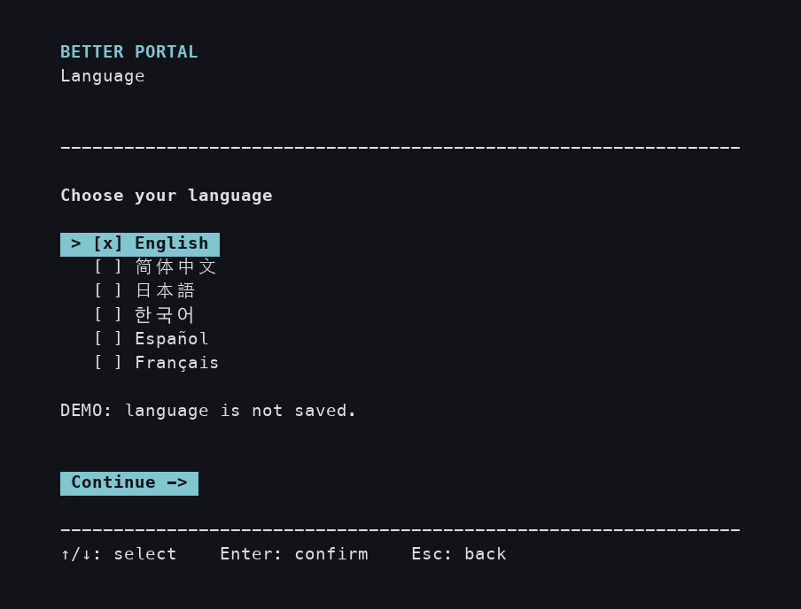
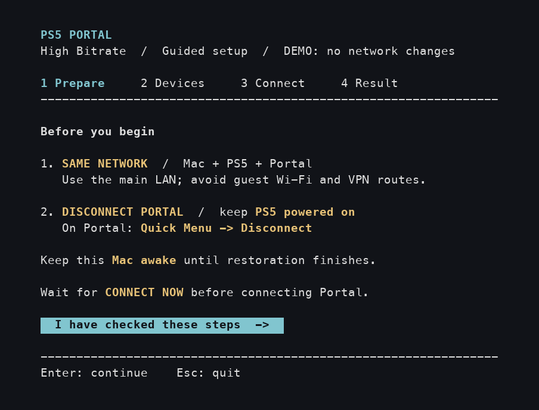
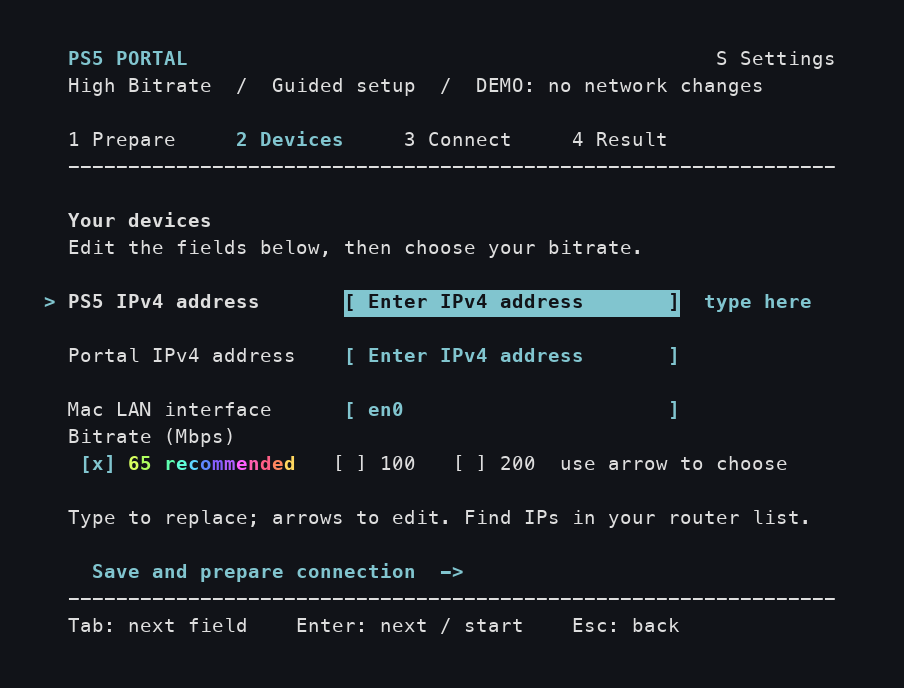
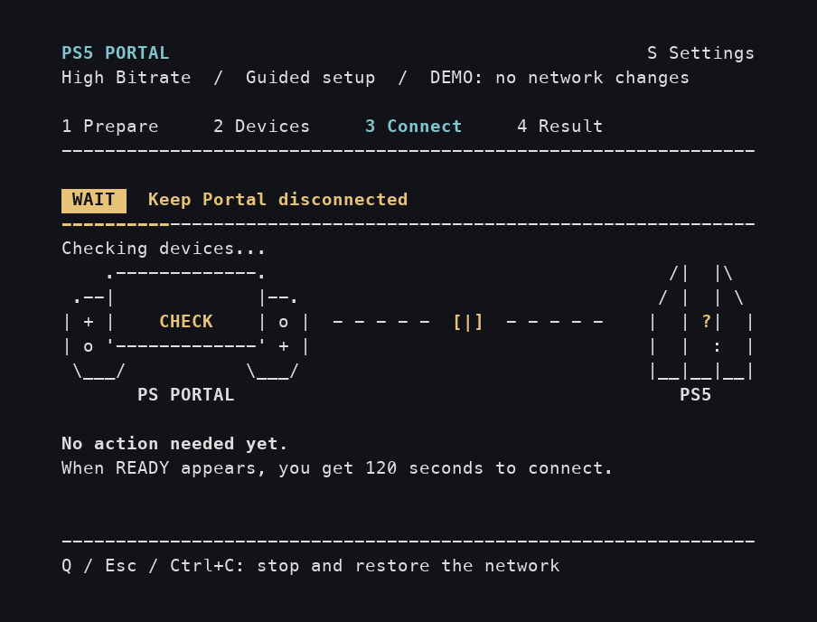
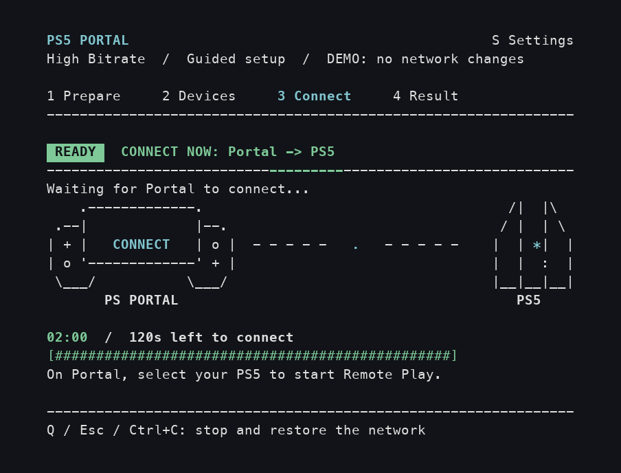
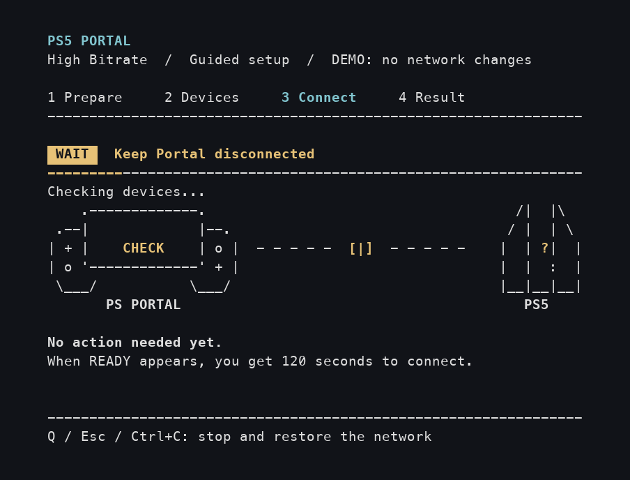
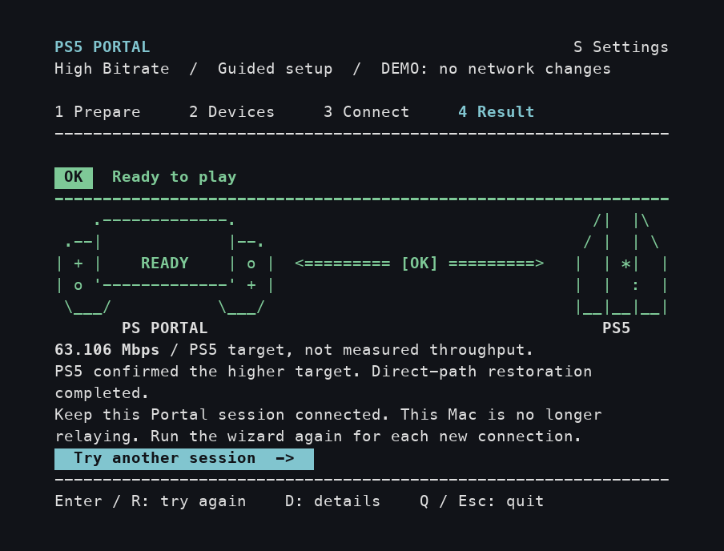
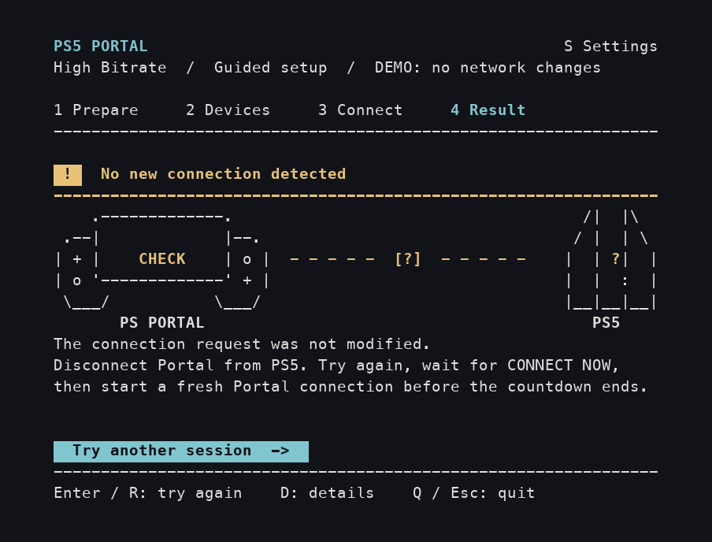
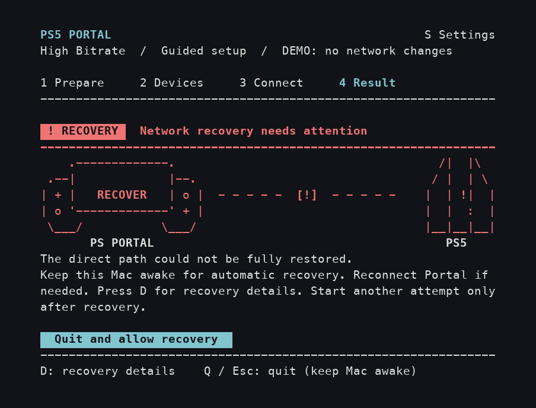

## Credits

The original bitrate approach comes from **[@atameric](https://github.com/atameric)** and [ps5-portal-high-bitrate](https://github.com/atameric/ps5-portal-high-bitrate). You can [support the original creator](https://buymeacoffee.com/atameric).

Licensed under [MIT](LICENSE). Independent community software; not affiliated with Sony or PlayStation.

# Better Portal

**macOS security preview:** The source and Homebrew launchers now use a signed macOS connection helper without sudo. A signed installer and device acceptance are still pending, so these launchers currently support demo mode only. See [setup, removal and release status](docs/macos-authorization.md).

**English** · [简体中文](README.zh-CN.md) · [日本語](README.ja.md) · [한국어](README.ko.md) · [Español](README.es.md) · [Français](README.fr.md)

Choose a higher picture-quality target when playing your PS5 through PlayStation Portal. Better Portal guides you through the setup on your Mac, one screen at a time.

[Install and open](#get-started) · [First session](#your-first-session) · [Find device addresses](#find-device-addresses) · [Get unstuck](#questions-and-fixes)

## Install and update with Homebrew (Mac)

If you use [Homebrew](https://brew.sh), install with these two commands. Homebrew installs Python and the required packages for you:

```sh
brew tap wchwawa/better-portal https://github.com/wchwawa/better-portal
brew install --HEAD wchwawa/better-portal/better-portal
```

Open with **`better-portal`** after the signed helper is installed and approved. Until then, preview with **`better-portal --demo`**. Close the wizard before updating, then run **`better-portal update`**. Addresses, language, bitrate and reports stay in your user folder. This channel follows the latest `main` branch but does not run its Python code with sudo. [Full guide and importing your old settings](docs/homebrew.md). The ZIP instructions below remain available for previews.

After each update, Terminal shows the installed version and its changes. Run **`better-portal changes`** to read them again, even offline. The headings follow your saved language; change descriptions keep the original English commit text.

## Windows quick start

The same guided TUI is available on **Windows 11 and Windows 10**. Windows device testing is still in progress; see the [Windows guide](WINDOWS.md) for requirements and troubleshooting.

1. Install [Python](https://www.python.org/downloads/windows/) (3.10 or newer, with the `py` launcher) and [Npcap](https://npcap.com/#download). Leave Npcap’s WinPcap compatibility mode unchecked.
2. Download and extract the whole [Better Portal ZIP](https://github.com/wchwawa/better-portal/archive/refs/heads/main.zip). Double-click **Setup-Windows.cmd** once and wait for **Setup complete**.
3. **Every time you play:** double-click **Start-Windows.cmd** and accept the Windows permission prompt. No commands or separate configuration tool are needed.
4. Choose your language, enter the two device IPv4 addresses, and use **← / →** to select the PC’s Wi-Fi or Ethernet adapter and bitrate. Keep Portal disconnected until **CONNECT NOW**, then connect within **120 seconds**.

The languages, **S** settings shortcut, animations, connection stages and result rules are shared with the Mac version shown below. Windows uses **PC LAN adapter** in Devices. Language, addresses and bitrate are remembered. A confirmed bitrate target still requires checking picture, sound and controls on Portal.

**On a Mac?** Use Homebrew above, or follow the ZIP instructions below.


## Before you start

Have these ready:

- A **Mac**, a **PS5** and a **PlayStation Portal**. Portal should already be able to play games from your own PS5 using Remote Play.
- All three connected to your **usual home router**. Mac and Portal can use home Wi-Fi; PS5 can use Wi-Fi or a network cable to that router. Avoid the guest network, and disconnect a VPN on the Mac if you use one.
- Internet access for installation, and the **password you use to log in to your Mac**.

This is an experimental community tool. Start with **65 Mbps**. Bitrate describes how much picture data can be sent each second; a higher setting can help detail, but can also cause stuttering on a less stable connection.

## Get started

These steps are for ZIP installs. If you installed with Homebrew, run **`better-portal`** and continue with **Your first session** below. In the guide, use that command wherever it says to open Start.command.

You only need to install once. Keep the downloaded folder: it contains the file you will open each time you play.

### A. Install Python

Python runs Better Portal. You do not need to write any code. If you already have Python 3.10 or newer, continue to B.

1. Open [Python's Mac download page](https://www.python.org/downloads/macos/). Under **Stable Releases**, find a **Python 3.14** release and click its **macOS installer** link. This is a version tested with Better Portal.
2. Open the downloaded `.pkg` file. Follow **Continue → Install**, then finish the installer.
3. In Finder, open **Applications → Python 3.14**, then double-click **Install Certificates.command**. Wait for `update complete`, then close that window. These are the [official Python installation steps](https://docs.python.org/3.14/using/mac.html).

### B. Download and set up Better Portal

1. Click **[Download Better Portal ZIP](https://github.com/wchwawa/better-portal/archive/refs/heads/main.zip)**.
2. Open **Finder** (the blue smiling-face icon), then **Downloads**. Double-click the ZIP if it has not already expanded. Open the resulting **better-portal-main** folder.
3. Double-click **Setup.command**. A **Terminal** window opens — a window that shows text and accepts keyboard input. Let the installation finish.
4. Wait for **`Setup complete.`**. Press **Return**, then close that window. If you see an error instead, use [the help below](#questions-and-fixes) before continuing.

| File in the downloaded folder | When to open it |
| --- | --- |
| **Setup.command** | Once, to install what Better Portal needs. |
| **Start.command** | Each time you want to set up a new Portal connection. |

Leave the other files in the folder. You do not need to open or edit them.

### C. Open the app

After installing and approving the signed connection helper, double-click **Start.command** in the same folder. It runs as your normal Mac user. Until a signed installer is available, use the demo command below to preview the wizard.

If macOS blocks either launcher, follow [“macOS won't open the file”](#macos-blocked). If the app asks for more room, drag a corner of the Terminal window to make it larger.

## Your first session

**Use your Mac keyboard in the wizard.** Click inside its Terminal window once to focus it. The colored buttons are selected with keys, not mouse clicks. **Return** on a Mac is the **Enter** key mentioned on screen.

| Key | What it does |
| --- | --- |
| **Return / Enter** | Confirm a choice, move to the next field, or activate the highlighted button. |
| **Tab** or **↑ / ↓** | Move between device fields. The `>` marks the current row. |
| **← / →** | Change the bitrate when its row is selected. `[x]` marks the chosen option. |
| **S** | Open Settings to change language. Press the letter once; no Return needed. |

The pictures below show the **actual app in demo mode**. The `DEMO` label and example addresses are for the illustrations. **Use your own device addresses and follow the timer in your app.** Click a picture to enlarge it.

### Choose your language

Use **↑ / ↓** to choose **English**, **简体中文**, **日本語**, **한국어**, **Español** or **Français**, then press **Return**. Your choice is remembered. If you go straight to Prepare, you already have a saved choice; **S** lets you change it.



### 1. Prepare your devices

On **Portal**, swipe left from the upper-right corner to open the quick menu, then choose **Disconnect**. Leave **Put the Connected PS5 in Rest Mode** off so PS5 stays on. See [Sony's Remote Play guide](https://www.playstation.com/en-nz/support/hardware/playstation-remote-play-on-psportal/) if you need help finding the menu.

**Keep Portal switched on and connected to Wi-Fi.** You are only ending its current play session. Keep the Mac awake with its lid open.

On the **Mac**, read the yellow reminders, then press **Return** to open Devices.



### 2. Enter two addresses and keep 65 Mbps

<a id="find-device-addresses"></a>
**First, find your PS5 and Portal addresses.** An IPv4 address is a device's number on your home network: four groups of numbers separated by dots. The two devices have different numbers.

1. Open the app or management page you normally use for your **home router or Wi-Fi**. Its name depends on your router or internet provider.
2. Look for **Devices**, **Connected devices** or **Clients**. Open the entry for **PS5** and write down its **IP address / IPv4 address**. Do the same for **PlayStation Portal**.
3. Keep both numbers beside you. Use the device addresses, not the router's own address, a MAC address or an internet speed-test result. **Do not copy `192.168.1.20` and `192.168.1.30` from this guide.**

For an illustrated example, [TP-Link Tether uses Local Device → Clients → the device](https://www.tp-link.com/us/support/faq/2611/). [ASUS has its own device-list guide](https://www.asus.com/us/support/faq/1005513/). If you do not know how to open your router's app or identify the devices, ask the person who set up your Wi-Fi or your internet provider for those two local addresses before continuing.

**Now fill in the Mac screen, from top to bottom:**

| Row | What to do, then press Return |
| --- | --- |
| **PS5 IPv4 address** | Type the PS5 address you found. |
| **Portal IPv4 address** | Type the Portal address you found. |
| **Mac LAN interface** | This is the Mac's network adapter name. Usually leave the suggested value, such as `en0`. If blank or using another adapter, [check it here](#mac-adapter). |
| **Bitrate (Mbps)** | Leave **65 recommended** selected for your first try. |
| **Save and prepare connection** | Press Return to begin. Keep Portal disconnected for now. |

When you move into a field, typing replaces its previous value. Use **↑** to go back if you make a mistake. Addresses and bitrate are saved for the next run.



<details>
<summary>Watch the keyboard steps and the moving 65 Mbps recommendation</summary>

This example enters sample addresses, leaves the suggested adapter, keeps 65 Mbps and moves to the start button. It loops; your inputs will stay on screen.


</details>

<details>
<summary>What about 100 or 200 Mbps?</summary>

On the bitrate row, use **← / →** or **Space** to choose. Try **100 Mbps** after a stable 65 Mbps session. **200 Mbps** is experimental and may increase stuttering. Compare the same game scene; more is not always better.

</details>

### 3. Wait on the Mac, then connect on Portal

**First: WAIT means wait.** Leave Portal disconnected while the Mac checks the devices and prepares the connection.



**Next: READY / CONNECT NOW means pick up Portal.** On Portal's Remote Play home screen, select your PS5 and connect as you normally would. You have **120 seconds**, starting at **02:00** on the Mac. The app is waiting for **you to make this connection on Portal**.



When Portal connects, leave it connected. Wait for the **Result** screen on the Mac before closing anything. If the timer runs out, follow the retry instructions in the result.

To stop early, press **Q** on the Mac and wait for the result. Keep the Mac awake while it restores the connection.

<details>
<summary>Watch a shortened connection example</summary>

This repeating demo moves from WAIT to READY, connection checks and success. It uses simulated events and a shortened wait. **Your app's countdown is the one to follow.**



</details>

### 4. Check the bitrate target, then check Portal

A green **Bitrate target confirmed** with **`[OK]`** means PS5 reported the higher target. **Check picture, sound and controls on Portal before playing.** The tool cannot verify playback or the devices' address mappings. If the screen stays black, disconnect and reconnect normally without Better Portal, then report the problem. Keep the Mac awake until restoration finishes. Press **Q** to quit; when the launcher says `Press Enter to close`, press Return and close its window.

The screenshots and animations show an earlier version, which called this result **Ready to play**. That message also confirmed the target only.



A number such as **63.106 Mbps** is the target PS5 reported, **not a measurement of actual video throughput**. The Mac no longer needs to relay this session.

**Next time you disconnect or turn off Portal:** open **Start.command** again and repeat the four steps. Saved addresses will be filled in; check them if your network has changed.

## If your result is different

These are **alternative outcomes**, not stages you should wait through after success.

| Message on the Mac | Your next action |
| --- | --- |
| **No new connection detected** / **No compatible startup captured** | Disconnect Portal from PS5. Press **Return** to retry. Connect on Portal only after the next READY prompt. |
| **Higher target not confirmed** / **Target reported; verification incomplete** | Press **D** for details. After network restoration, reconnect normally or retry with 65 Mbps. |
| **Attempt stopped** | Read the restoration status. If restored, retry with Return or quit with Q. |
| **Network recovery needs attention** | Keep the Mac awake. Press **D** for recovery details and wait for recovery before another attempt. |

<details>
<summary>See separate retry and recovery examples</summary>

**No new connection:** start another attempt and make a fresh Portal connection after READY.



**Recovery needs attention:** keep the Mac awake and follow D: details.



The [result animation](docs/images/result-terminal-art.gif) shows separate simulated outcomes for comparison; one successful session does not pass through all of them.

</details>

## Language settings

Press **S**, use the **arrow keys** to choose a language, then **Enter**, **Esc** or **S** to return. Changes apply immediately and are saved; Esc closes the panel without undoing the change. Your inputs and current step stay in place.

During connection, the countdown continues while Settings is open. **Q** still stops the attempt. The panel closes when network restoration starts.

<details>
<summary>See live language switching and the four additional translations</summary>


</details>

<a id="troubleshooting-and-recovery"></a>

## Questions and fixes

<a id="macos-blocked"></a>
**macOS won't open the file: “developer cannot be verified” or “Apple cannot check…”**

After trying to open the file downloaded from this repository, go to **Apple menu → System Settings → Privacy & Security**. Find its blocked-file notice, choose **Open Anyway**, then confirm **Open** if you trust this download. [Apple's illustrated instructions](https://support.apple.com/en-us/102445) explain the prompts. A “will damage your computer” alert is a different case; stop and follow Apple's guidance for that alert.

**Setup shows a Python or certificate error instead of “Setup complete”.**

Complete [step A](#a-install-python), including **Install Certificates.command**. Close the failed setup window, then reopen **Setup.command**. If it still fails, copy the error text when asking for help.

**The connection helper is unavailable or not approved.**

Install the signed Better Portal package when it is released, then enable the helper in the app and approve it in System Settings. Until then, use demo mode. The wizard does not ask for sudo.

**The text is cut off or the app asks for a larger window.**

Drag a corner of the Terminal window to enlarge it. The app needs at least 72 columns and 24 rows of text. It resumes when there is enough space.

**A device did not respond, or the picture stutters.**

Keep PS5 and Portal awake. Recheck both current addresses and the home Wi-Fi connection. For stuttering, try 65 Mbps or disconnect Portal and reconnect normally without Better Portal.

**Will it save my Mac password?**

No. macOS controls authorization. Retrying inside the same open wizard does not ask again.

**How do I get help?**

[Open an issue](https://github.com/wchwawa/better-portal/issues) with the step and message shown, macOS and Portal versions, and selected bitrate. Remove device addresses from screenshots before sharing. Raw reports and packet captures can contain private network information; keep them local.

<a id="terminal-help"></a>

<details>
<summary>Terminal help: opening the folder, preview mode and a missing Python file</summary>

To open Terminal manually, press **Command (⌘) + Space**, type **Terminal**, then press Return.

1. Type `cd` followed by **one space**.
2. Drag the **better-portal-main folder** from Finder into the Terminal window, then press Return. This tells Terminal which folder to use.
3. Copy **one command at a time** from below, paste it into Terminal and press Return. Copy only the command text.

If Start cannot find `.venv/bin/python`, run setup from this folder first:

```sh
./Setup.command
```

Then launch a real session:

```sh
./Start.command
```

To **preview only**, after setup:

```sh
.venv/bin/python portal_tui.py --demo
```

To **preview without animation**:

```sh
.venv/bin/python portal_tui.py --demo --no-animations
```

Both preview commands simulate a connection without your devices. They need no administrator password, change no networking and save no settings. Quit the preview before opening Start.command for a real session.

</details>

<a id="mac-adapter"></a>

<details>
<summary>The Mac LAN interface is blank, or I use a USB / Ethernet adapter</summary>

The interface is a name such as `en0`, not your Wi-Fi name or an IP address. To check it, open Terminal using the instructions above and run:

```sh
networksetup -listallhardwareports
```

For Wi-Fi, find the **Hardware Port: Wi-Fi** section and use the name beside **Device:**. For a cable connection, use the section for the connected Ethernet adapter. Enter that Device name in Better Portal. If you cannot tell which adapter is in use, include this question when asking for help.

</details>

<details>
<summary>Already use Git and Terminal?</summary>

```sh
git clone https://github.com/wchwawa/better-portal.git
cd better-portal
./Setup.command
./Start.command
```

</details>

**Linux?** See the upstream [Linux / automatic setup guide](https://github.com/atameric/ps5-portal-high-bitrate/blob/main/AUTOMATION.md).
