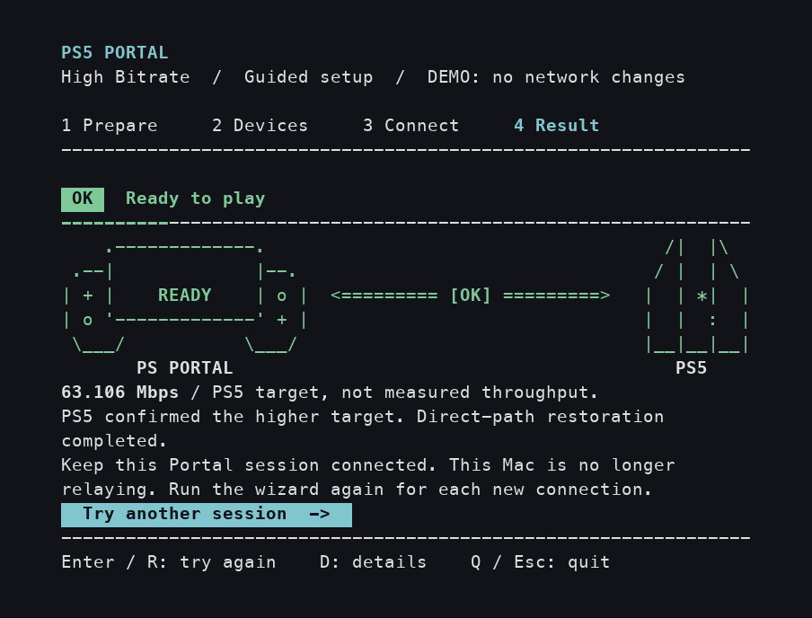

# Better Portal

**English** · [简体中文](README.zh-CN.md)

A guided Mac app for choosing a higher bitrate target for PS5 Remote Play on your PlayStation Portal.

> **Built on [atameric/ps5-portal-high-bitrate](https://github.com/atameric/ps5-portal-high-bitrate).** Shout-out to [@atameric](https://github.com/atameric) for the original idea and implementation. Better Portal builds on that work with a guided terminal interface. The original MIT license and contributor history are preserved.

Choose your language, enter your device addresses, choose a bitrate, and connect when the app says **READY**. Saved settings, a two-minute countdown and clear results guide you through each session.

[Get started](#get-started) · [See the four steps](#your-first-session) · [Questions and fixes](#questions-and-fixes)

## Before you start

- A PS5 and PlayStation Portal that can already connect and play normally.
- A Mac, PS5 and Portal on the **same home network**. PS5 can use Ethernet while Portal uses Wi-Fi. Avoid guest Wi-Fi, VPN routes and networks that isolate devices.
- **Python 3.10 or newer** on the Mac. Check with `python3 --version`, or install it from [Python's macOS downloads](https://www.python.org/downloads/macos/).
- Your Mac login password. The app requests administrator access to set up the connection.

This is an experimental community tool. Compatibility and picture quality depend on your devices, firmware and network. Start with **65 Mbps**; a higher target is not a guarantee of a smoother picture or lower delay.

## Get started

1. [Download Better Portal](https://github.com/wchwawa/better-portal/archive/refs/heads/main.zip) and unzip it.
2. Open the folder and double-click **Setup.command**. This installs what the app needs. Press Enter when setup finishes.
3. Double-click **Start.command** whenever you want to start a new Portal session.

Enter your Mac password if prompted. Terminal does not display characters as you type the password.

Prefer Terminal? Run setup once:

```sh
git clone https://github.com/wchwawa/better-portal.git
cd better-portal
./Setup.command
```

Then open the app from that folder:

```sh
./Start.command
```

Keep the Terminal window at least **72 columns by 24 rows**. Enlarge it if the app asks.

## Your first session

The images below show the actual app in demo mode, using example addresses and shortened waiting times.

### Choose your language

On your first launch, choose **English**, **简体中文**, **日本語**, **한국어**, **Español** or **Français** with **↑ / ↓**. The picker previews your language as you move. Press **Enter** to save your choice for this session and future launches.


To change languages during setup, press **S** to open **Settings**. Use the **arrow keys** to move through the two rows of languages. The interface changes immediately and saves your choice. Press **Enter**, **Esc** or **S** to return to the same screen with your inputs intact.


During connection, the countdown continues with Settings open. **Q / Ctrl+C** still stops the attempt; the panel closes automatically when network restoration starts. Demo mode lets you try every language but does not save your choice.

The device fields, connection states, results and recovery guidance are translated too.


### 1. Prepare your devices

Disconnect Portal from PS5 using **Quick Menu → Disconnect**. Keep PS5 powered on, Portal awake, and the Mac awake until the attempt finishes.

The yellow highlights call out what matters before you continue. Press **Enter** when you are ready.


### 2. Enter your addresses and choose a bitrate

Find the PS5 and Portal **IPv4 addresses** in your router's connected-device list. Enter them in the highlighted fields. Keep the suggested **Mac LAN interface** unless you are using a different network adapter.

Move between fields with **Tab** or **↑ / ↓**. Typing replaces the selected field. On the bitrate row, use **← / →** or **Space** to choose:

| Profile | When to use it |
| --- | --- |
| **65 Mbps — recommended** | Start here. The moving rainbow marks the recommended option. |
| **100 Mbps** | Try it after a stable 65 Mbps session and compare the same game scene. |
| **200 Mbps — experimental** | An optional experiment; it may increase stutter and may not reach the target. |

The arrow-key hint sits to the right of the choices. Press **Enter** to move to **Save and prepare connection**, then Enter again to start. Your addresses and selected profile are remembered for next time.


### 3. Connect when READY appears

During **WAIT**, keep Portal disconnected. The artwork follows device checks and preparation.

When **READY / CONNECT NOW** appears, select your PS5 on Portal and start Remote Play. You have **120 seconds**, shown as a countdown from **02:00**.

The connection line changes as the app sees your request, PS5 acceptance and bitrate confirmation. Once connected, leave Portal connected while the app finishes and restores the direct connection.


To stop an attempt, press **Q**, **Esc** or **Ctrl+C** and wait for the result. Keep the Mac awake while restoration is in progress.

### 4. Read the result and play

**Ready to play** means the higher target was confirmed, the local check passed, and the direct connection was restored. Keep that Portal session connected; you can quit the app with **Q** or **Esc**.



| Result | What to do |
| --- | --- |
| **Ready to play** · green `[OK]` | Keep playing. The Mac is no longer relaying this session. |
| **No new connection detected** / **No compatible startup captured** | Disconnect Portal, retry, and connect only after READY appears. |
| **Higher target not confirmed** / **Target reported; verification incomplete** · amber `[?]` | Check **D: details**. Reconnect normally, or retry with 65 Mbps. |
| **Attempt stopped** · `[X]` | The attempt was cancelled. Read the restoration status, then retry or quit. |
| **Network recovery needs attention** · red `[!]` | Keep the Mac awake for automatic recovery. Press **D** for recovery details. Wait for recovery before another attempt. |

A value such as **63.106 Mbps** is the target reported by PS5, not a measurement of actual video throughput. The result artwork describes the finished attempt; it does not monitor your connection afterward.

## Questions and fixes

**How do I switch languages?**

Press **S** to open **Settings**, then use the **arrow keys**. Changes apply immediately and are remembered for next time. **Esc** closes Settings; it does not undo the change. Your device addresses, bitrate choice and current step stay the same.

**Do I need to run it again after disconnecting or turning off Portal?**

Yes. Each new Remote Play connection needs a new run. Open **Start.command**, check your saved settings, and reconnect after READY.

**Does the Mac need to stay on while I play?**

After **Ready to play**, the Mac is no longer relaying and the app can be closed. During setup, cancellation or a recovery warning, keep the Mac awake until restoration completes.

**Will it remember my Mac password?**

Better Portal does not save your password. macOS controls whether another launch needs authorization. Retrying inside the same open wizard does not ask again.

**How do I go back to normal?**

Disconnect Portal and reconnect normally without running Better Portal. There is no firmware modification to undo.

**The app says a device did not respond.**

Wake PS5 and Portal, confirm their current IP addresses, and check that all three devices are on the same home network. If you see a duplicate-IP message, check the router's device list before retrying.

**The picture stutters with a higher profile.**

Try 65 Mbps, or reconnect normally. More bitrate is not always better for your network.

**Start.command cannot find `.venv/bin/python`, or I cannot open a launcher.**

Run **Setup.command** in the downloaded folder first. You can also open Terminal, type `cd `, drag that folder into the window, press Enter, and run `./Setup.command`, then `./Start.command`.

**Can I look around without connecting my devices?**

After setup, run this from the project folder. Demo mode needs no administrator access and does not change your network or save settings:

```sh
.venv/bin/python portal_tui.py --demo
```

For a still interface, add `--no-animations`:

```sh
sudo .venv/bin/python portal_tui.py --no-animations
```

**What about Windows or Linux?**

This guided interface is for **macOS**. The original project has separate [Windows](https://github.com/atameric/ps5-portal-high-bitrate/blob/main/WINDOWS.md) and [Linux / automatic setup](https://github.com/atameric/ps5-portal-high-bitrate/blob/main/AUTOMATION.md) guides.

**Where can I get help?**

[Open an issue](https://github.com/wchwawa/better-portal/issues) with the message shown, your macOS and Portal versions, and the selected profile. Redact device addresses from screenshots and keep raw packet captures private. Settings and session reports stay on your Mac.

## Credits

The original bitrate approach comes from **[@atameric](https://github.com/atameric)** and [ps5-portal-high-bitrate](https://github.com/atameric/ps5-portal-high-bitrate). Thank you to the original project's contributors and testers. You can [support the original creator](https://buymeacoffee.com/atameric).

Better Portal's guided Mac experience is maintained by [@wchwawa](https://github.com/wchwawa). Licensed under [MIT](LICENSE). Independent community software; not affiliated with Sony or PlayStation.
