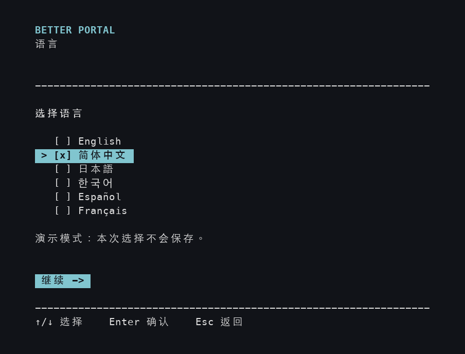
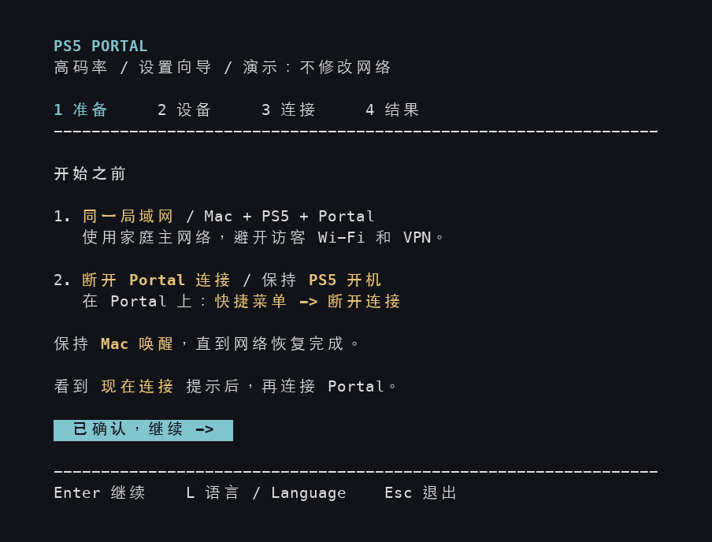
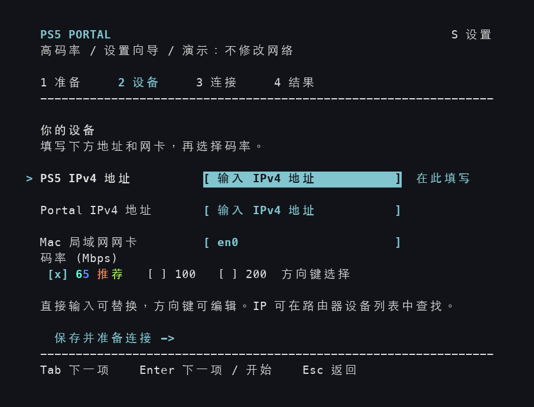
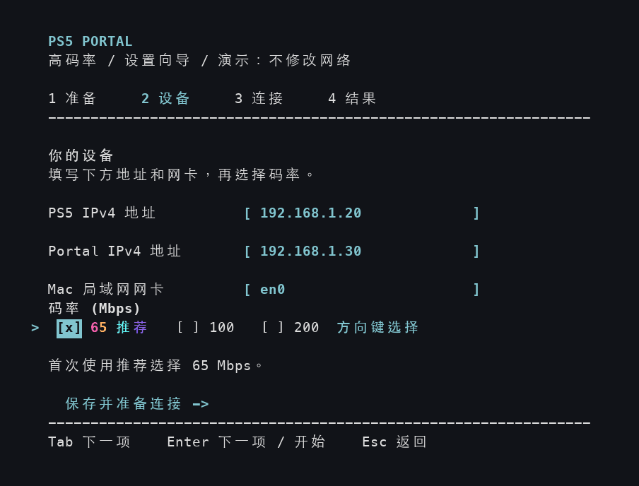
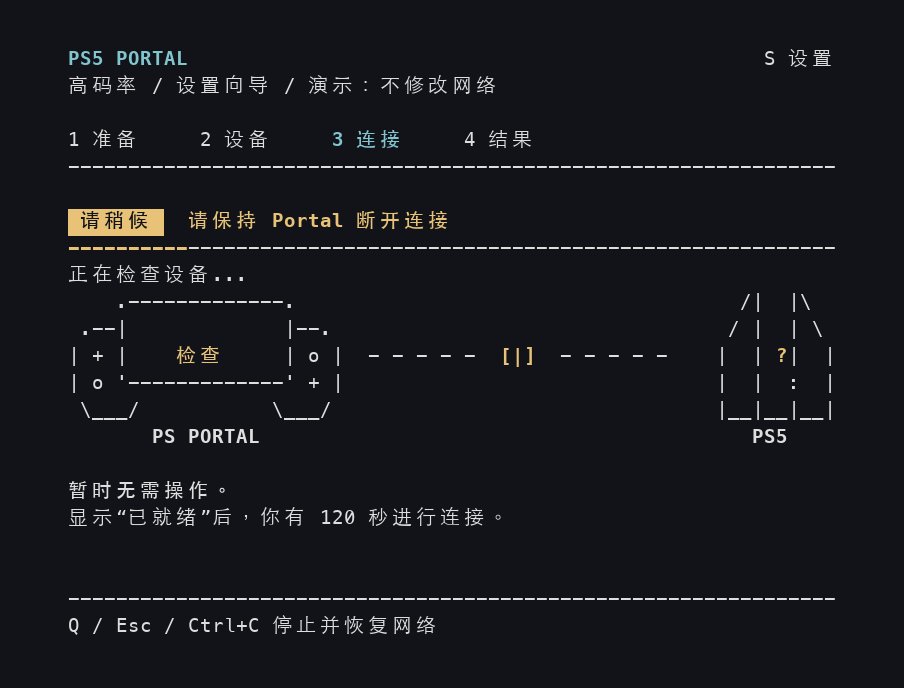
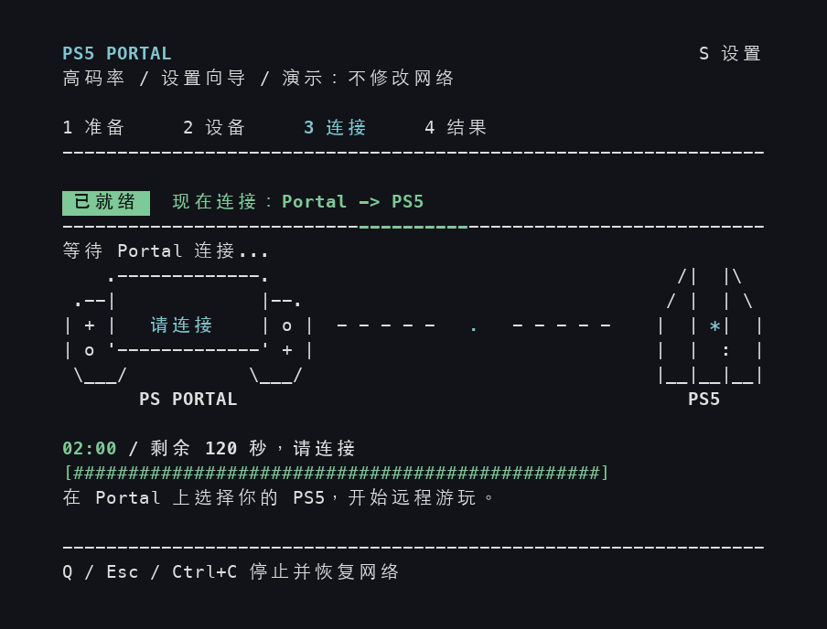
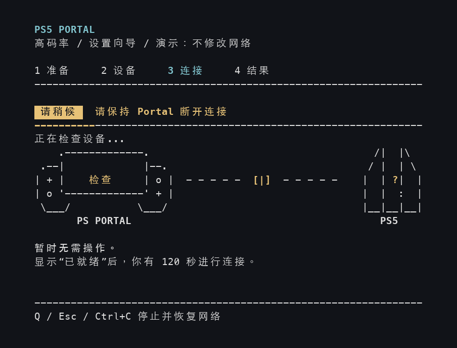
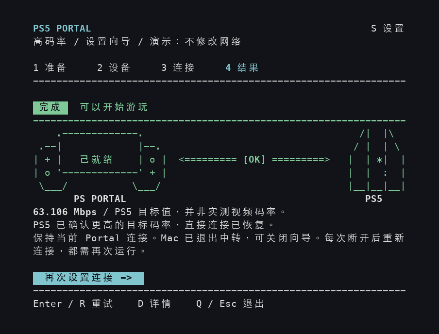
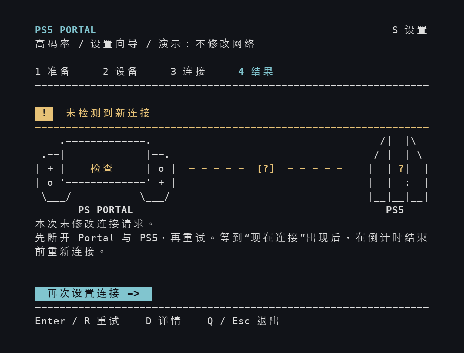
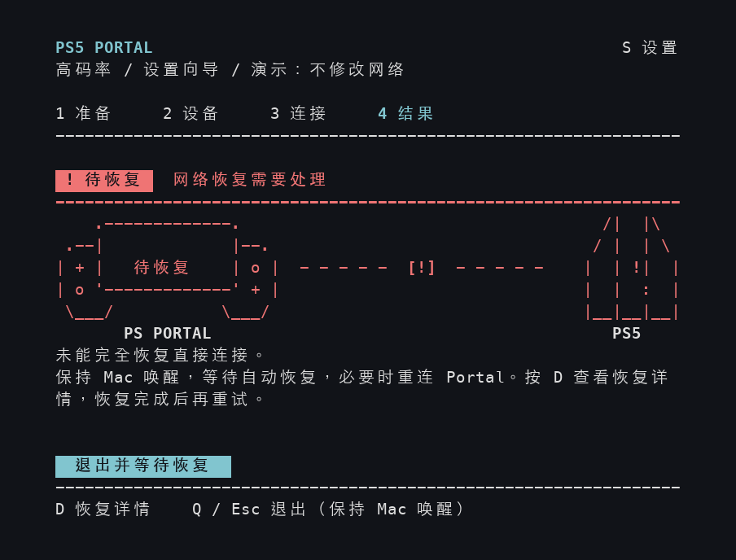

## 致谢

原始码率调整方法来自 **[@atameric](https://github.com/atameric)** 和 [ps5-portal-high-bitrate](https://github.com/atameric/ps5-portal-high-bitrate)。你可以[支持原作者](https://buymeacoffee.com/atameric)。

采用 [MIT](LICENSE) 许可证。独立社区软件；与 Sony 或 PlayStation 无隶属关系。

# Better Portal

[English](README.md) · **简体中文** · [日本語](README.ja.md) · [한국어](README.ko.md) · [Español](README.es.md) · [Français](README.fr.md)

[](https://discord.gg/C957je4ehv)

用 PlayStation Portal 玩自己的 PS5 时，通过 Mac 上的逐步向导选择更高的画面码率目标。

[安装与打开](#安装与打开) · [第一次使用](#第一次使用) · [查找设备地址](#find-device-addresses) · [遇到问题](#常见问题)

## 通过 Homebrew 安装和更新（Mac）

如果已经使用 [Homebrew](https://brew.sh)，在终端依次运行以下两行。Python 和依赖会自动安装：

```sh
brew tap wchwawa/better-portal https://github.com/wchwawa/better-portal
brew install --HEAD wchwawa/better-portal/better-portal
```

以后运行 **`better-portal`** 打开向导。更新前关闭向导，再运行 **`better-portal update`**。地址、语言、码率和报告保留在用户目录里。此方式跟随最新的 `main` 分支；真实连接仍会按需提示输入 Mac 密码。[完整说明与旧设置导入](docs/homebrew.md)。也可以继续使用下方的 ZIP 安装方式。

每次更新后，终端会显示实际安装的版本和更新内容。运行 **`better-portal changes`** 可随时再次查看，也支持离线使用。标题会使用你保存的语言，具体更新说明保留原始英文提交描述。

## Windows 快速开始

**Windows 11 和 Windows 10** 可以使用同一套 TUI 向导。Windows 实机验证仍在进行；详细步骤和排错请看 [Windows 中文指南](WINDOWS.zh-CN.md)。

1. 下载 [Better Portal ZIP](https://github.com/wchwawa/better-portal/archive/refs/heads/main.zip)，右键 → **全部解压缩**，打开解压后的文件夹。
2. 双击 **Start-Windows.cmd**。它会检查 Python 并安装缺少的程序依赖。若未安装 Python，会通过 Windows 包管理器安装；包管理器不可用时，会打开 Python 官方安装页面。
3. 如果提示安装 **Npcap**，按自动打开的官方网站完成安装。**不要勾选 WinPcap 兼容模式**。安装结束后，回到启动窗口按 **Enter** 继续。已经安装 Npcap 时会跳过这一步。
4. 允许 Windows 的权限请求。选择语言、输入两个设备的 IPv4 地址，用 **← / →** 选择电脑的 Wi-Fi 或以太网网卡及码率。Portal 保持断开，看到 **现在连接 / CONNECT NOW** 后，在 **120 秒**内连接 PS5。

**以后只需双击 Start-Windows.cmd。**无需单独运行 Setup，也无需输入命令。此快速启动支持 x64 Windows 电脑。

语言、**S** 设置快捷键、动画、连接阶段和结果判断与下方 Mac 演示共用代码。Windows 的设备页显示 **PC 局域网网卡**。语言、地址和码率都会保存。目标码率确认后，仍请在 Portal 上检查画面、声音和操作。

**使用 Mac？** 可以选择上方的 Homebrew 方式，或按下方的 ZIP 步骤安装。


## 开始前需要什么

准备好以下设备和信息：

- 一台 **Mac**、一台 **PS5** 和一台 **PlayStation Portal**。Portal 已经能够通过远程游玩，正常玩你自己的 PS5。
- 三台设备连接到**家里的同一台路由器**。Mac 和 Portal 可以使用家里的 Wi-Fi；PS5 可以连接这个 Wi-Fi，也可以用网线连接这台路由器。避开访客网络；如果 Mac 正在使用 VPN，请先断开。
- 安装时可以上网，以及**你登录 Mac 时使用的密码**。

这是一个实验性社区工具，建议先用 **65 Mbps**。码率表示每秒可以传送多少画面数据；调高后可能保留更多细节，但网络不稳定时也可能更卡。

## 安装与打开

下面是 ZIP 安装步骤。如果已经通过 Homebrew 安装，运行 **`better-portal`**，直接看后面的**第一次使用**即可。指南中提到打开 Start.command 时，Brew 用户运行这个命令。

只需要安装一次。请保留下载的整个文件夹，以后每次使用都从这里打开。

### A. 安装 Python

Python 用来运行 Better Portal，你不需要写代码。如果已经安装 Python 3.10 或更新版本，可以直接看 B。

1. 打开 [Python 官方 Mac 下载页](https://www.python.org/downloads/macos/)，在 **Stable Releases** 中找到一个 **Python 3.14** 版本，点击它下面的 **macOS installer**。Better Portal 已测试过这个版本系列。
2. 打开下载的 `.pkg` 文件，按提示选择**继续 → 安装**，完成安装。
3. 在访达中打开**应用程序 → Python 3.14**，双击 **Install Certificates.command**。等到出现 `update complete` 后关闭窗口。这一步也在 [Python 官方安装说明](https://docs.python.org/3.14/using/mac.html)中。

### B. 下载并完成首次设置

1. 点击 **[下载 Better Portal ZIP](https://github.com/wchwawa/better-portal/archive/refs/heads/main.zip)**。
2. 打开**访达**（蓝色笑脸图标），进入**下载**。如果下载的 ZIP 没有自动解压，双击它，然后打开生成的 **better-portal-main** 文件夹。
3. 双击 **Setup.command**。会打开一个**终端**窗口，也就是显示文字、通过键盘操作的窗口。等待安装完成。
4. 看到 **`Setup complete.`** 后，按键盘上的 **Return（回车）**，再关闭这个窗口。如果出现错误而不是完成提示，请先看[常见问题](#常见问题)。

| 文件夹里的文件 | 什么时候打开 |
| --- | --- |
| **Setup.command** | 首次安装时打开一次。 |
| **Start.command** | 每次需要设置新的 Portal 连接时打开。 |

其他文件保留在原处即可，无需打开或修改。

### C. 打开向导

双击同一文件夹中的 **Start.command**。如果出现 **`Password:`**，输入**登录 Mac 的密码**，再按 **Return**。**输入时不会显示字母，也不会显示圆点，这是正常现象。** 如果出现 `Sorry, try again`，重新输入密码即可。

如果 macOS 拦截启动文件，请看[“macOS 不让我打开文件”](#macos-blocked)。如果向导提示窗口太小，拖动终端窗口的一角，把它放大。

## 第一次使用

**向导使用 Mac 键盘操作。** 先在终端窗口内点击一次，让它接收键盘输入。彩色按钮用按键选择，不需要用鼠标点击。Mac 键盘上的 **Return**，就是界面中写的 **Enter**。

| 按键 | 用途 |
| --- | --- |
| **Return / Enter** | 确认选择、移动到下一项，或执行当前高亮按钮。 |
| **Tab** 或 **↑ / ↓** | 在设备填写项之间移动，左侧的 `>` 指向当前行。 |
| **← / →** | 选中码率这一行后，用左右方向键切换；`[x]` 表示已选中。 |
| **S** | 打开设置并更换语言。按一次字母键即可，不需要再按回车。 |

下方图片来自**实际程序的演示模式**。其中的“演示”字样和地址用于说明操作。**请填写你自己设备的地址，按自己窗口中的倒计时操作。** 点击图片可以放大查看。

### 先选择语言

用 **↑ / ↓** 选择 **简体中文、English、日本語、한국어、Español 或 Français**，按 **Return** 确认。向导会记住选择。如果直接进入准备页，说明以前已经选过语言；按 **S** 可以修改。



### 1. 准备设备

在 **Portal** 上，从屏幕右上角向左滑，打开快捷菜单，选择**断开连接**。找不到菜单时，可以参考 [Sony 的远程游玩说明](https://www.playstation.com/en-nz/support/hardware/playstation-remote-play-on-psportal/)。

**Portal 继续开机，并保持连接 Wi-Fi。** 这里只结束当前的游玩连接。Mac 也保持唤醒，笔记本不要合上盖子。

回到 **Mac**，读完黄色提醒，按 **Return** 进入设备页。



### 2. 填写两个地址，先使用 65 Mbps

<a id="find-device-addresses"></a>
**先找到 PS5 和 Portal 各自的地址。** IPv4 地址是设备在家庭网络中的编号，由四组数字组成，中间用英文句点分隔。两台设备的编号不同。

1. 打开平时管理**家庭路由器或 Wi-Fi** 的 App 或管理页面。名称取决于路由器品牌或宽带运营商。
2. 找到**设备、已连接设备、终端或 Clients** 之类的列表。打开 **PS5** 的条目，记下它的 **IP 地址 / IPv4 地址**；再找到 **PlayStation Portal**，记下它的地址。
3. 把这两个地址放在手边。需要的是设备地址，不是路由器自身的地址、MAC 地址或测速结果。**不要照抄本指南里的 `192.168.1.20` 和 `192.168.1.30`。**

例如，[TP-Link Tether 的图文说明](https://www.tp-link.com/us/support/faq/2611/)使用 **Local Device → Clients → 对应设备**；[华硕也有设备列表的图文指南](https://www.asus.com/us/support/faq/1005513/)。如果不知道怎么打开路由器管理页面，或不能确定哪个条目是自己的设备，请先请教当时设置家庭 Wi-Fi 的人或宽带运营商，确认这两个局域网地址。

**然后从上到下填写 Mac 上的界面：**

| 当前行 | 做完这一项后按 Return |
| --- | --- |
| **PS5 IPv4 地址** | 输入刚才找到的 PS5 地址。 |
| **Portal IPv4 地址** | 输入刚才找到的 Portal 地址。 |
| **Mac 局域网网卡** | 这是 Mac 网络适配器的名称。通常保留已有值，例如 `en0`。如果为空或使用其他网卡，请看[这里](#mac-adapter)。 |
| **码率 (Mbps)** | 第一次先保持选中 **65 推荐**。 |
| **保存并准备连接** | 按 Return 开始准备，此时 Portal 仍保持断开。 |

进入一个填写项后，直接输入会替换原来的内容。填错时用 **↑** 返回修改。地址和码率会保存，供下次使用。



<details>
<summary>展开观看填写顺序和 65 Mbps 的彩虹动效</summary>

这段演示依次填写示例地址，保留网卡，选择 65 Mbps，再移动到开始按钮。动图会循环；实际窗口里填写的内容会保留。



</details>

<details>
<summary>什么时候尝试 100 或 200 Mbps？</summary>

选中码率这一行后，用 **← / →** 或**空格**切换。65 Mbps 稳定后，可以尝试 **100 Mbps**。**200 Mbps** 是实验选项，可能增加卡顿。比较同一个游戏场景，数值更大不一定更好。

</details>

### 3. 先等 Mac 准备好，再操作 Portal 连接

**先看到“请稍候”：继续等待。** Mac 正在检查设备和准备连接，Portal 保持断开。



**接着看到“已就绪 / 现在连接”：拿起 Portal 操作。** 在 Portal 的远程游玩主页选择自己的 PS5，像平时一样连接。Mac 上从 **02:00** 开始倒计时，你有 **120 秒**。这时程序在等**你亲自在 Portal 上发起连接**。



Portal 连上后，保持连接，等 Mac 显示**结果页**再关闭窗口。如果倒计时结束仍未连接，按照结果页中的提示重试。

需要提前停止时，在 Mac 上按 **Q**，等待结果出现。网络恢复期间保持 Mac 唤醒。

<details>
<summary>展开观看一段缩短等待时间的连接演示</summary>

这段动图从“请稍候”到“现在连接”，再到连接检查和成功结果。它使用模拟事件并缩短等待，会循环播放。**请以你自己窗口中的倒计时为准。**



</details>

### 4. 确认目标码率，再检查 Portal

绿色的**目标码率已确认**和 **`[OK]`** 表示 PS5 报告了更高的目标值。**开始游玩前，请在 Portal 检查画面、声音和操作。** 工具无法验证实际音画或设备的地址映射。若持续黑屏，请先不用 Better Portal，正常断开后重连，再反馈问题。恢复结束前保持 Mac 唤醒。按 **Q** 退出；显示 `Press Enter to close` 后，按 Return 关闭窗口。

截图和动图来自较早版本，当时这条结果显示为**可以开始游玩**；它同样只确认了目标码率。



**63.106 Mbps** 之类的数字是 PS5 报告的目标码率，**不是实测视频传输速度**。Mac 已经不需要为本次连接中转数据。

**下次断开连接或关闭 Portal 后**：重新打开 **Start.command**，再完成这四步。之前的地址会自动填好；如果家庭网络有变化，请重新核对。

## 结果和上图不一样时

下面是**不同的运行结果**，不是成功后还需要依次经历的阶段。

| Mac 上的提示 | 接下来怎么做 |
| --- | --- |
| **未检测到新连接 / 未捕获到兼容的连接请求** | 先断开 Portal 与 PS5，按 **Return** 重试。等新的“现在连接”出现后，再操作 Portal 连接。 |
| **未确认高码率目标 / 已报告高码率，但验证未完成** | 按 **D** 查看详情。网络恢复后，可以正常重连，或使用 65 Mbps 重试。 |
| **本次运行已停止** | 阅读网络恢复状态。确认已恢复后，按 Return 重试或按 Q 退出。 |
| **网络恢复需要处理** | 保持 Mac 唤醒，按 **D** 查看恢复详情。恢复完成后再尝试下一次。 |

<details>
<summary>展开查看重试和恢复警告的独立示例</summary>

**未检测到新连接**：重新尝试，等到“现在连接”后，再发起新的 Portal 连接。



**网络恢复需要处理**：保持 Mac 唤醒，按 D 查看详情并按提示处理。



[结果动图](docs/images/result-zh-CN.gif)轮流展示不同的模拟结果，方便对照；一次成功连接不会依次经过所有这些结果。

</details>

## 使用过程中切换语言

按 **S**，用**方向键**选择语言，按 **Enter、Esc 或 S** 返回。修改立即生效并自动保存；Esc 只关闭面板，不会撤销修改。已填写的内容和当前步骤都会保留。

连接期间打开设置，倒计时仍会继续。按 **Q** 仍可停止本次操作。开始恢复网络时，设置面板会自动关闭。

<details>
<summary>展开查看即时切换，以及日语、韩语、西班牙语和法语界面</summary>


</details>

## 常见问题

<a id="macos-blocked"></a>
**macOS 不让我打开文件，提示无法验证开发者或 Apple 无法检查文件。**

尝试打开本仓库下载的文件后，进入**苹果菜单 → 系统设置 → 隐私与安全性**。找到该文件被阻止的提示；确认信任这次下载后，选择**仍要打开**并确认。可以对照 [Apple 的图文说明](https://support.apple.com/zh-cn/102445)。如果提示“将损坏你的电脑”，这是另一类警告，请先停止，并按 Apple 针对该提示的说明处理。

**Setup 没有显示完成，而是出现 Python 或证书错误。**

完成 [A. 安装 Python](#a-安装-python)，包括 **Install Certificates.command**。关闭失败的设置窗口，重新打开 **Setup.command**。如果仍然失败，求助时提供错误文字。

**密码一直不对，或提示当前账户不能使用 sudo。**

请输入登录 Mac 的密码。如果当前账户没有管理员权限，请管理这台 Mac 的人协助授权启动。

**文字显示不全，或提示窗口太小。**

拖动终端窗口的一角，把它放大。向导需要至少容纳 72 列、24 行文字；空间足够后会继续显示。

**设备没有响应，或画面卡顿。**

保持 Portal 唤醒，重新核对当前地址和家庭 Wi-Fi 连接。画面卡顿时先尝试 65 Mbps，或断开 Portal，不运行 Better Portal，直接正常重连。

**会保存我的 Mac 密码吗？**

不会，授权由 macOS 管理。在同一个已经打开的向导里重试，不会再次询问密码。

**怎么反馈问题？**

请[创建 Issue](https://github.com/wchwawa/better-portal/issues)，写清楚卡在哪一步、窗口里的提示、macOS 和 Portal 版本，以及所选码率。分享截图前遮住设备地址；原始报告和抓包可能包含私人网络信息，请保留在本机。

<a id="terminal-help"></a>

<details>
<summary>终端操作帮助：打开项目文件夹、预览界面，以及找不到 Python 文件</summary>

手动打开终端：按 **Command（⌘）+ 空格**，输入**终端**，再按 Return。

1. 输入 `cd`，后面加**一个空格**。
2. 把访达中的 **better-portal-main 文件夹**拖进终端，再按 Return。这是在告诉终端接下来使用哪个文件夹。
3. 从下面**一次复制一条命令**，粘贴进终端，按 Return。只复制命令本身。

如果 Start 提示找不到 `.venv/bin/python`，先在这个文件夹里运行设置：

```sh
./Setup.command
```

然后启动真实连接向导：

```sh
./Start.command
```

安装后，想**只预览界面**：

```sh
.venv/bin/python portal_tui.py --demo
```

想**预览并关闭动效**：

```sh
.venv/bin/python portal_tui.py --demo --no-animations
```

这两条预览命令都会模拟连接，无需操作真实设备、无需管理员密码，不修改网络，也不保存设置。体验完先退出预览，再用 Start.command 设置真实连接。

</details>

<a id="mac-adapter"></a>

<details>
<summary>Mac 局域网网卡这一项为空，或我使用 USB / 有线网卡</summary>

这里填写的是 `en0` 这类名称，不是 Wi-Fi 名称或 IP 地址。按照上面的说明打开终端，运行：

```sh
networksetup -listallhardwareports
```

如果通过 Wi-Fi 上网，找到 **Hardware Port: Wi-Fi** 那一段，使用 **Device:** 后的名称。如果插网线上网，找到当前有线网卡对应的那一段，把 Device 名称填回向导。不确定正在使用哪块网卡时，可以在求助时说明情况。

</details>

<details>
<summary>已经熟悉 Git 和终端？</summary>

```sh
git clone https://github.com/wchwawa/better-portal.git
cd better-portal
./Setup.command
./Start.command
```

</details>

**使用 Linux？** 请参阅原项目的 [Linux / 自动运行指南](https://github.com/atameric/ps5-portal-high-bitrate/blob/main/AUTOMATION.md)。
